# PrepLens

A public archive of NST placement interview experiences, round by round, written by seniors for juniors. Students sign in with their college Google account, share an experience (anonymously if they choose), and juniors read, search, save and learn from them. An admin team reviews what is posted. An AI prep guide summarises each company and cites the experiences behind every claim.

This README holds **every diagram** of the system. The reasoning behind each choice is in [`docs/design/02-decisions.md`](docs/design/02-decisions.md) and [`docs/design/05-design-patterns.md`](docs/design/05-design-patterns.md), each with its own diagram.

## Contents

1. [Stack and repository layout](#1-stack-and-repository-layout)
2. [Run it](#2-run-it)
3. [Architecture diagrams](#3-architecture-diagrams) (system, layers, request pipeline, trust boundaries)
4. [Data model](#4-data-model) (ER diagram)
5. [Class diagrams](#5-class-diagrams) (layers and ports, domain model)
6. [Sequence diagrams](#6-sequence-diagrams) (sign-in, submit, moderate, vote, edit, AI guide, delete account, company merge)
7. [State and activity diagrams](#7-state-and-activity-diagrams)
8. [Where everything else is](#8-where-everything-else-is)

## 1. Stack and repository layout

| Part | Technology |
|---|---|
| Web app | Next.js 16 (App Router), React, TypeScript, Tailwind 4, GSAP, Three.js, Motion |
| API | Node.js, Express 5, TypeScript, Zod, pino |
| Data and identity | Supabase Postgres, Supabase Auth (Google), Row Level Security |
| AI | Google Gemini, called only from the API |
| Tests | Vitest and Supertest (API), SQL tests (database), Chrome automation (UI) |

```
apps/web        Next.js app: landing page and the working pages
apps/api        Express API: routes, controllers, services, domain, infrastructure
packages/shared Zod schemas, enums and response types used by both apps
supabase/       migrations (0001 to 0010) and repeatable database tests
docs/design/    requirements, decisions, patterns, diagrams, audit
```

## 2. Run it

```bash
npm install
cp apps/api/.env.example apps/api/.env      # fill in the Supabase and Gemini values
npm test                                    # builds shared, runs the API tests
npm run dev:api                             # API on :4000
cd apps/web && npm run dev -- -p 3100       # web on :3100
```

Database tests live in `supabase/tests/` (each rolls itself back). A parallel-request check is in `apps/api/scripts/concurrency-check.mjs`.

## 3. Architecture diagrams

### 3.1 System context

Who talks to what. The browser never talks to the database tables directly, and only the API holds the Gemini key and the Supabase service-role key.

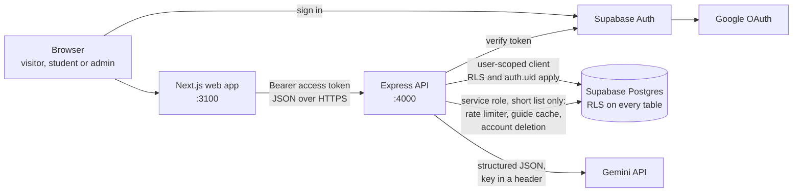

### 3.2 Layers inside the API

Dependencies point inward. The domain imports nothing from Express, Supabase or services. Only `container.ts` names concrete classes.

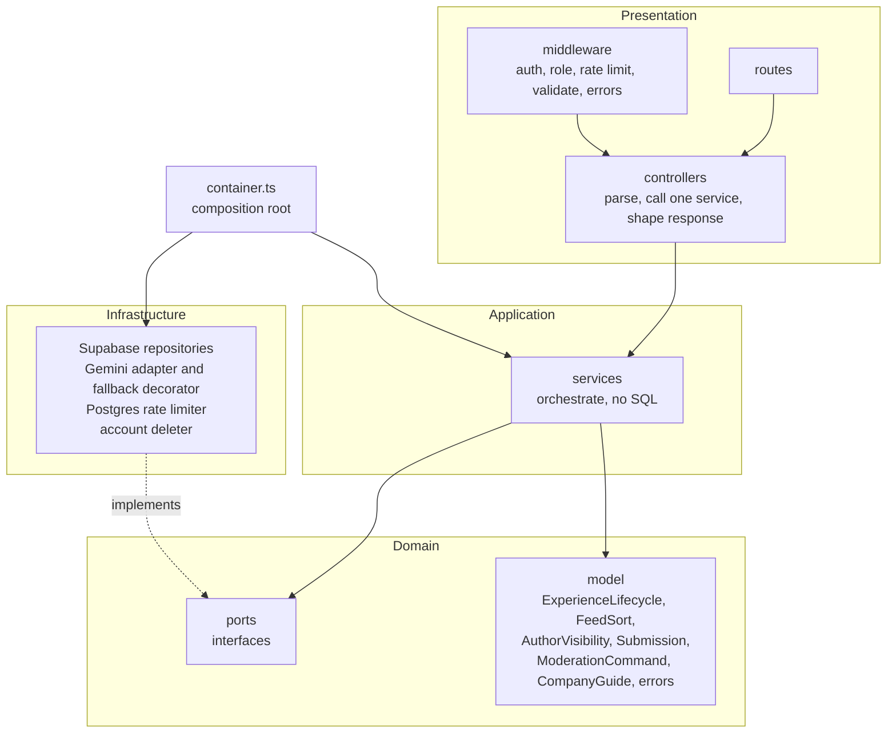

### 3.3 Request pipeline

The same chain runs on every route. A route is just a list of these steps.

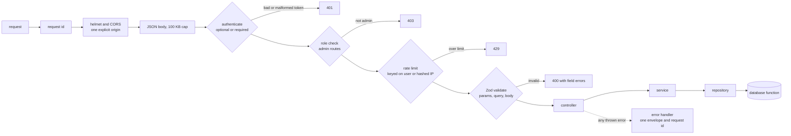

### 3.4 Trust boundaries

Every rule is enforced at more than one of these points, so a bug in one layer cannot become a leak.

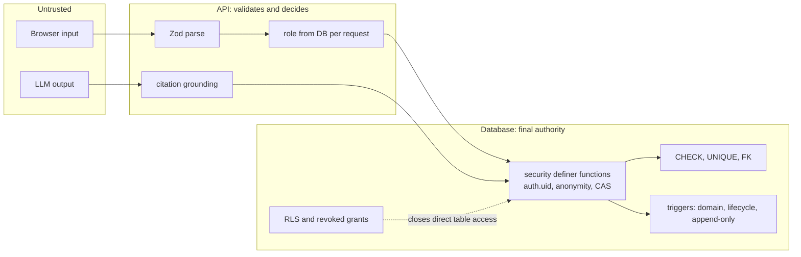

## 4. Data model

The tables are the entity model (decision ADR-25): the rules that protect the data live in the database, not in copies of the entities in TypeScript.

```mermaid
erDiagram
  PROFILES {
    uuid id PK
    text email UK
    text full_name
    int graduation_batch
    text branch
    text role "student or admin"
  }
  COMPANIES {
    uuid id PK
    text slug UK
    text name
    text_array aliases
    text status "active or pending"
    int experience_count
  }
  EXPERIENCES {
    uuid id PK
    uuid company_id FK
    uuid author_id FK "nullable"
    text role
    text drive_type
    int interview_year
    text outcome
    text campus
    text status "5 states"
    bool is_anonymous
    timestamptz consented_at "CHECK: required to publish"
    jsonb pending_update
    int upvote_count
    tsvector search_tsv
  }
  INTERVIEW_ROUNDS {
    uuid id PK
    uuid experience_id FK
    int position "UNIQUE with experience"
    text name
    text tips
  }
  QUESTIONS {
    uuid id PK
    uuid round_id FK
    int position "UNIQUE with round"
    text text
    text topic
  }
  VOTES {
    uuid user_id PK
    uuid experience_id PK
  }
  BOOKMARKS {
    uuid user_id PK
    uuid experience_id PK
  }
  REPORTS {
    uuid id PK
    uuid experience_id FK
    uuid reporter_id FK "nullable"
    text reason
    text status
  }
  MODERATION_LOGS {
    uuid id PK
    text action
    uuid experience_id FK "nullable"
    uuid admin_id FK
    text company_name "copied"
    text role "copied"
  }
  COMPANY_GUIDES {
    uuid id PK
    uuid company_id FK "UNIQUE"
    text fingerprint
    jsonb content
    uuid_array source_ids
  }
  RATE_LIMITS {
    text key PK
    text action PK
    timestamptz window_start PK
    int count
  }

  PROFILES ||--o{ EXPERIENCES : "authors, nullable"
  COMPANIES ||--o{ EXPERIENCES : has
  EXPERIENCES ||--|{ INTERVIEW_ROUNDS : "composed of"
  INTERVIEW_ROUNDS ||--o{ QUESTIONS : contains
  PROFILES ||--o{ VOTES : casts
  EXPERIENCES ||--o{ VOTES : receives
  PROFILES ||--o{ BOOKMARKS : keeps
  EXPERIENCES ||--o{ BOOKMARKS : "saved in"
  EXPERIENCES ||--o{ REPORTS : "subject of"
  PROFILES ||--o{ REPORTS : files
  PROFILES ||--o{ MODERATION_LOGS : performs
  EXPERIENCES ||--o{ MODERATION_LOGS : concerns
  COMPANIES ||--o| COMPANY_GUIDES : "summarised by"
```

## 5. Class diagrams

### 5.1 Services, ports and adapters

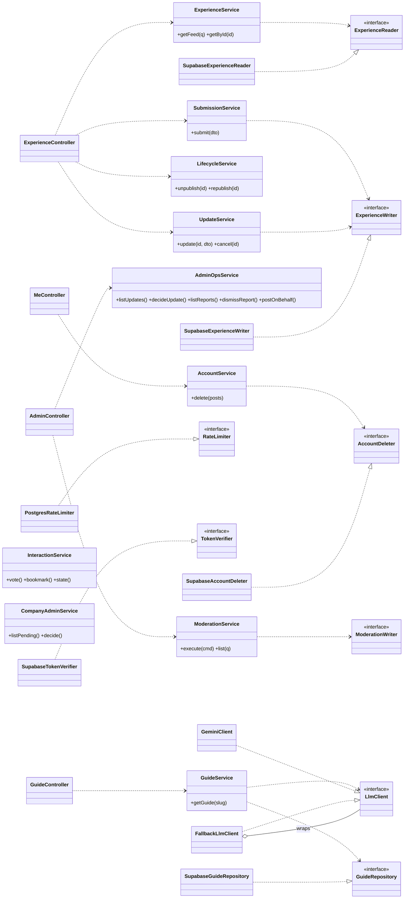

### 5.2 Domain model (TypeScript classes that carry behaviour)

```mermaid
classDiagram
direction TB

class Submission {
  <<abstract>>
  +toPayload() SubmitPayload
  #normaliseRounds() RoundPayload[]
  #validateSpecific() void
}
class QuickSubmission
class DetailedSubmission
Submission <|-- QuickSubmission
Submission <|-- DetailedSubmission
class SubmissionFactory { +create(dto) Submission }
SubmissionFactory ..> Submission

class FeedSort {
  <<abstract>>
  +name
  +nextCursor(card) string
  +after(cursor) FeedAfter
  #keyOf(card) string
  #resume(key, id) FeedAfter
}
class NewestFirst
class InterviewDateFirst
FeedSort <|-- NewestFirst
FeedSort <|-- InterviewDateFirst

class AuthorVisibility { <<abstract>> +toPublic() PublicAuthor }
class AnonymousAuthor
class NamedAuthor
AuthorVisibility <|-- AnonymousAuthor
AuthorVisibility <|-- NamedAuthor
class AuthorVisibilityFactory { +fromDb(raw) AuthorVisibility }
AuthorVisibilityFactory ..> AuthorVisibility

class ExperienceLifecycle {
  +TRANSITIONS
  +canMove(from, to) bool
  +actionsFor(ctx) ExperienceAction[]
}

class ModerationCommand { <<interface>> +action +experienceId +run(writer) }
class ApproveCommand
class RejectCommand
class RemoveCommand
class ReinstateCommand
ModerationCommand <|.. ApproveCommand
ModerationCommand <|.. RejectCommand
ModerationCommand <|.. RemoveCommand
ModerationCommand <|.. ReinstateCommand
class ModerationCommandFactory { +create(action, id, note) }
ModerationCommandFactory ..> ModerationCommand

class CompanyGuide {
  +fingerprint
  +sourceIds
  +isStale(fp) bool
  +citesOnly(ids) bool
  +toView(company, stale) GuideView
}

class AppError {
  <<abstract>>
  +code
  +httpStatus
  +fields
}
class ValidationError
class AuthenticationError
class ForbiddenError
class NotFoundError
class ConflictError
class RateLimitedError
class NotEnoughDataError
class UpstreamError
AppError <|-- ValidationError
AppError <|-- AuthenticationError
AppError <|-- ForbiddenError
AppError <|-- NotFoundError
AppError <|-- ConflictError
AppError <|-- RateLimitedError
AppError <|-- NotEnoughDataError
AppError <|-- UpstreamError
```

## 6. Sequence diagrams

### 6.1 Sign in, and the college-domain rule

The domain check is a database trigger, so it holds no matter which client calls Supabase Auth.

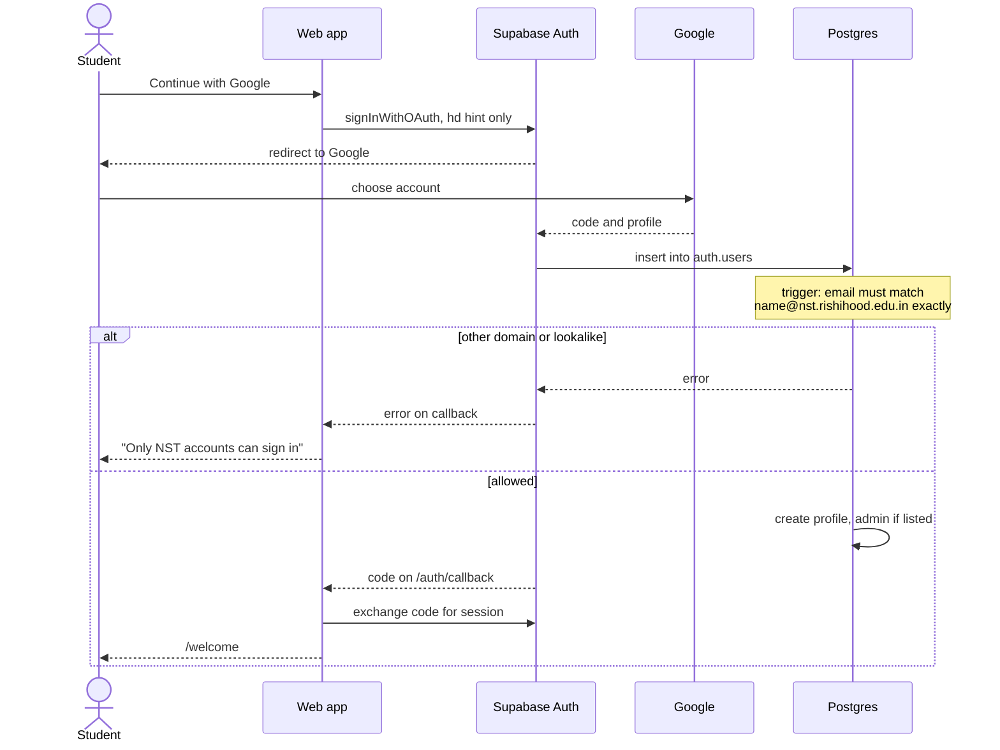

### 6.2 Submit an experience

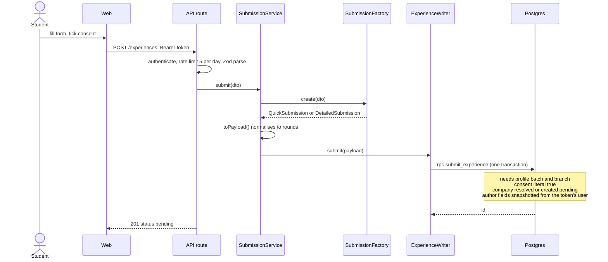

### 6.3 Admin decision, with compare-and-set

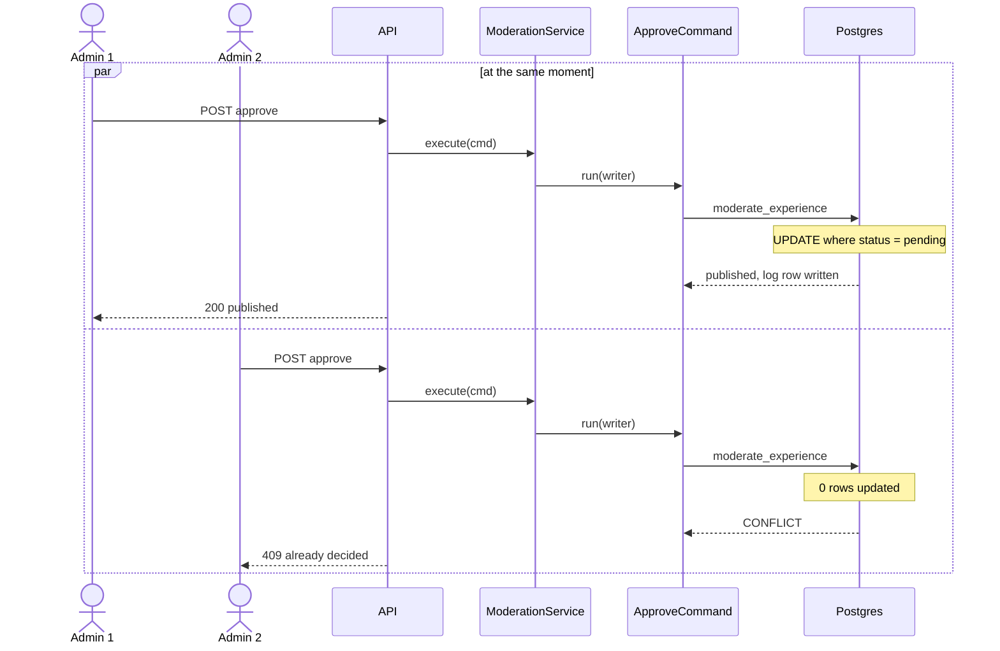

### 6.4 Vote, idempotent under a double tap

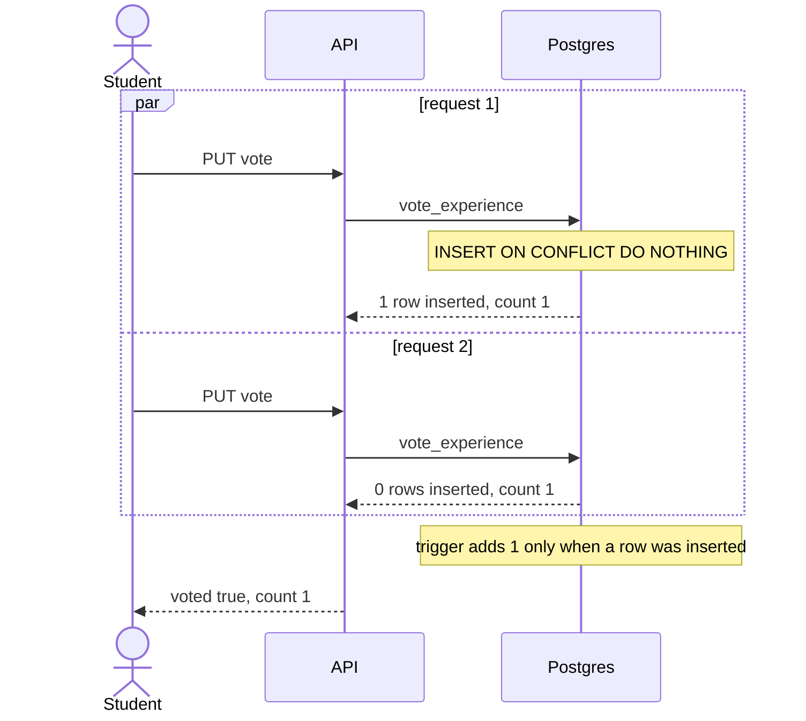

### 6.5 Edit or update the result of a live post

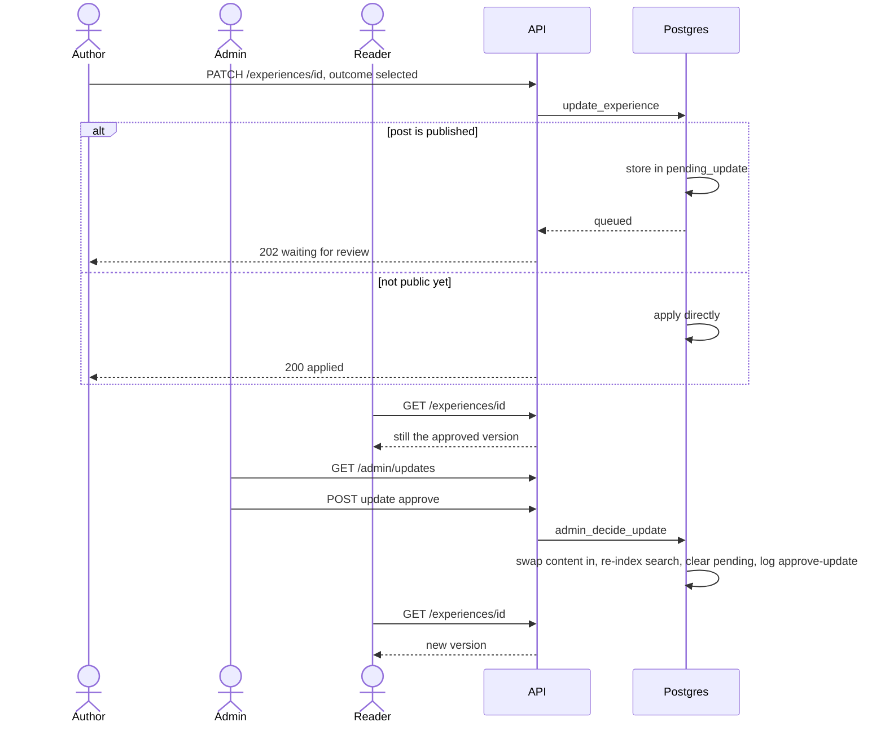

### 6.6 AI prep guide: grounded, cached, degradable

```mermaid
sequenceDiagram
  actor V as Visitor
  participant G as GuideService
  participant SR as GuideSourceReader
  participant GR as GuideRepository
  participant L as FallbackLlmClient
  participant M as Gemini

  V->>G: getGuide(slug)
  G->>SR: forCompany(slug)
  SR-->>G: published experiences, authors anonymised
  alt fewer than 3
    G-->>V: 409 not enough data
  else enough
    G->>G: fingerprint = hash of ids and update times
    G->>GR: find(companyId)
    alt cached and fingerprint matches
      GR-->>G: guide
      G-->>V: guide, no model call
    else stale or missing
      G->>L: generateJson(prompt, schema)
      loop each model while failure is transient
        L->>M: generateContent
        M-->>L: JSON or 404, 429, 5xx
      end
      alt model unavailable
        L-->>G: UpstreamError
        alt old guide cites only still-published posts
          G-->>V: old guide marked stale
        else a cited post was withdrawn
          G-->>V: 503, never show withdrawn content
        end
      else answered
        G->>G: Zod parse, keep real citations, drop uncited claims
        G->>G: counts and top topics computed in code
        G->>GR: save (upsert on company)
        G-->>V: guide
      end
    end
  end
```

### 6.7 Delete my account

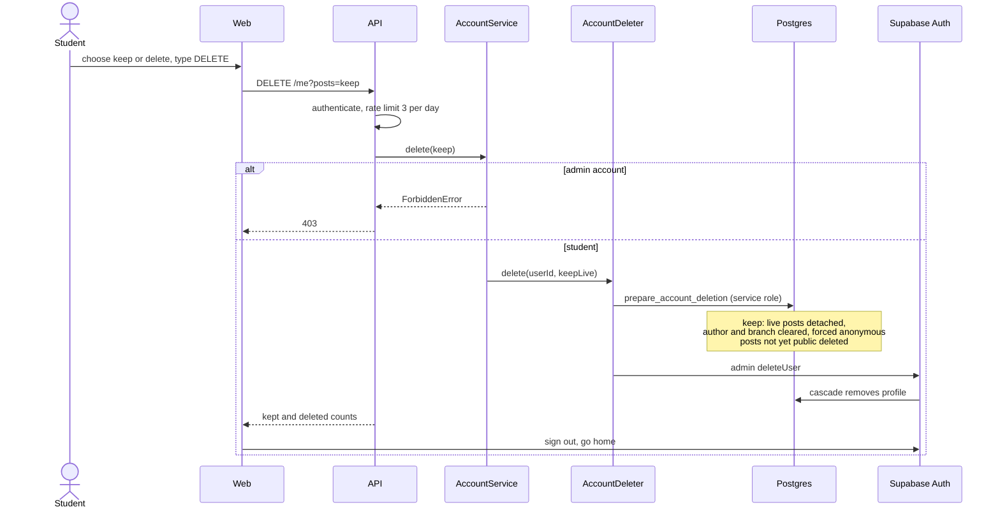

### 6.8 Company merge

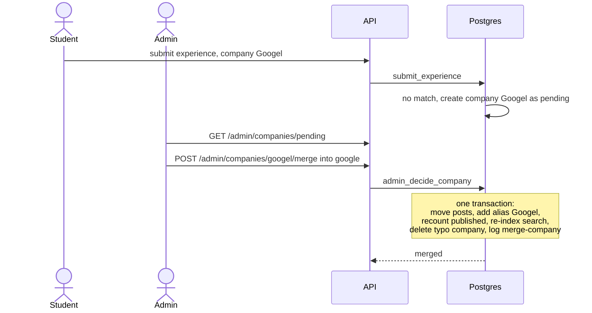

## 7. State and activity diagrams

### 7.1 Experience lifecycle (state machine)

Enforced by a database trigger and described in TypeScript by `ExperienceLifecycle`; a test fails if the two tables differ. Nothing is ever hard-deleted by an admin.

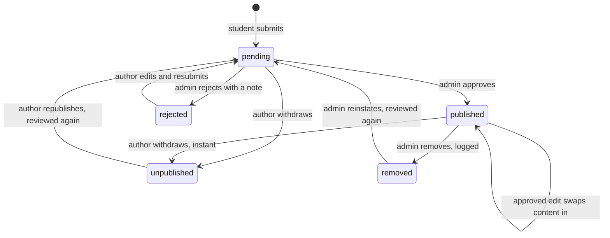

### 7.2 A change to a live post

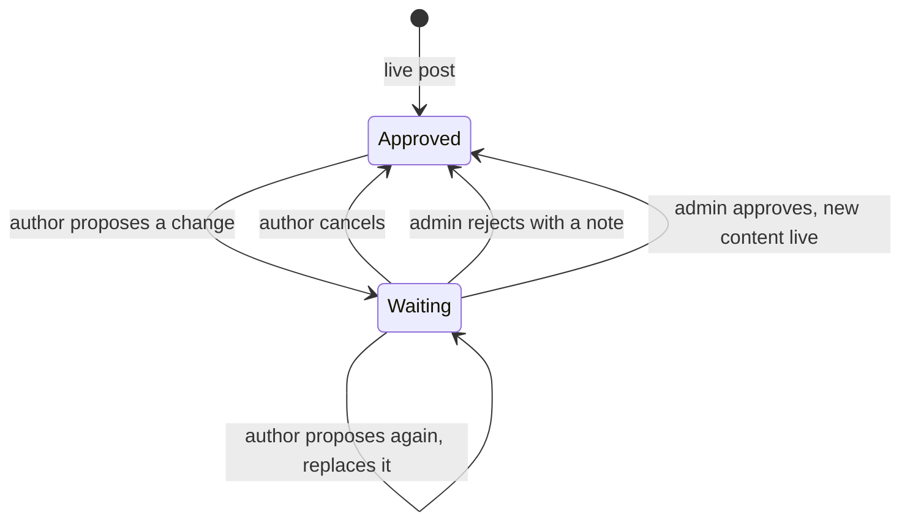

### 7.3 From writing to being read

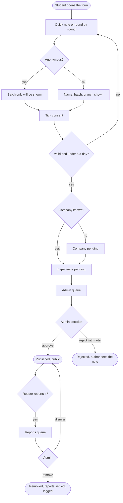

## 8. Where everything else is

| What | Where |
|---|---|
| Requirements, actors, use cases | [`docs/design/01-requirements.md`](docs/design/01-requirements.md) |
| Every decision with its reason and a diagram | [`docs/design/02-decisions.md`](docs/design/02-decisions.md) |
| Every design pattern with a diagram | [`docs/design/05-design-patterns.md`](docs/design/05-design-patterns.md) |
| OOP and SOLID, where each is applied | [`docs/design/04-oop-and-solid.md`](docs/design/04-oop-and-solid.md) |
| API contract and endpoint table | [`docs/design/07-api-design.md`](docs/design/07-api-design.md) |
| Database schema, indexes, RLS | [`docs/design/08-database-schema.md`](docs/design/08-database-schema.md) |
| Errors and concurrency | [`docs/design/09-errors-and-concurrency.md`](docs/design/09-errors-and-concurrency.md) |
| Audit of code against the design | [`docs/design/10-compliance.md`](docs/design/10-compliance.md) |
