# 2. Design Decisions

Format of every record: **Problem → Decision → Why (system design concept) → Rejected alternatives and trade-offs.**
Status is `Proposed` until the owner approves; then `Accepted`. If a decision changes, do not delete it: mark it `Superseded by ADR-xx` and say what forced the change.

Every decision below has a diagram. All other diagrams are in the root [`README.md`](../../README.md). Index: [ADR-01 Layers](#adr-01) · [02 Relational DB](#adr-02) · [03 Rounds as tables](#adr-03) · [04 RLS + server authz](#adr-04) · [05 Domain restriction in DB](#adr-05) · [06 Anonymity](#adr-06) · [07 Votes](#adr-07) · [08 Keyset pagination](#adr-08) · [09 Cache vs per-user state](#adr-09) · [10 Append-only log](#adr-10) · [11 Rate limiting](#adr-11) · [12 AI guide](#adr-12) · [13 Rendering](#adr-13) · [14 Atomic writes](#adr-14) · [15 Lifecycle state machine](#adr-15) · [16 Validation](#adr-16) · [17 Search](#adr-17) · [18 Consent](#adr-18) · [19 Error envelope](#adr-19) · [20 Scale ladder](#adr-20) · [21 Express API service](#adr-21) · [22 Authentication](#adr-22) · [23 User-scoped DB access](#adr-23) · [24 Monorepo + shared schemas](#adr-24) · [25 Closed tables + functions](#adr-25) · [26 Test accounts](#adr-26) · [27 API in JavaScript](#adr-27) · [28 Stitch web UI](#adr-28)

---

<a id="adr-01"></a>
## ADR-01 Layered architecture with ports and adapters
**Status:** Accepted
- **Problem:** Next.js makes it easy to put queries inside React components. Then rules (who may see what) are scattered, untestable and duplicated.
- **Decision:** Four layers: Presentation (Next.js pages in `apps/web`; Express routes and controllers in `apps/api`), Application (services), Domain (entities, policies, interfaces), Infrastructure (Supabase repositories, Gemini client, rate limiter). Dependencies point inward; the domain imports nothing from Supabase, Express or Next. The layers live in the Express API (ADR-21).
- **Why:** *Separation of concerns* and the *Dependency Inversion Principle*. A service can be tested with a fake repository and no database. Swapping Gemini or the database touches one adapter.
- **Rejected:** Calling Supabase straight from components (fast to write; rules leak into UI, cannot unit test). A full hexagonal framework (more ceremony than a team project needs).
- **Cost:** More files and interfaces. Accepted because the evaluation and long-term maintenance both reward it.

**Diagram**

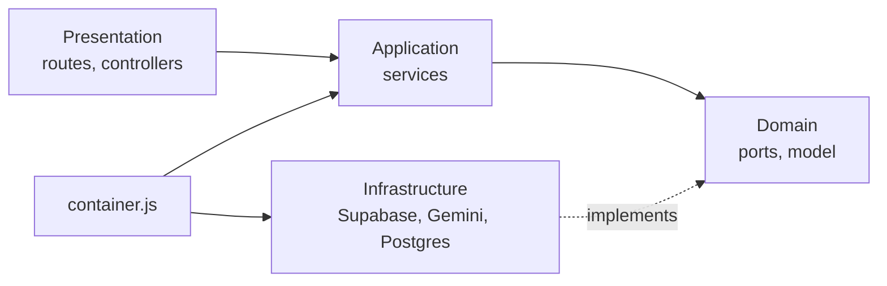


<a id="adr-02"></a>
## ADR-02 Relational database (Postgres) instead of documents
**Status:** Accepted
- **Problem:** The data is relational: users, companies, experiences, votes, reports, moderation, all with integrity rules ("one vote per user per experience", "a log row must name an admin").
- **Decision:** Supabase Postgres with foreign keys, unique and check constraints.
- **Why:** *Data integrity belongs in the database* (constraints cannot be raced or bypassed by a forgotten code path). Normalisation gives one source of truth for company names and author identity.
- **Rejected:** MongoDB/document store: embedding is convenient for reads but integrity then depends on application code; many-to-many data (votes, bookmarks) is awkward.
- **Cost:** Feeds need a join or a denormalised copy; handled in ADR-08 and the schema.

**Diagram**

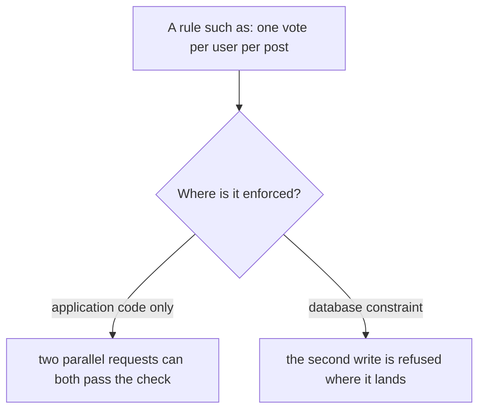


<a id="adr-03"></a>
## ADR-03 Rounds and questions as real tables
**Status:** Accepted
- **Problem:** An experience has an ordered list of rounds, each with an ordered list of questions. Store as JSON on the experience, or as rows?
- **Decision:** `interview_rounds(experience_id, position)` and `questions(round_id, position)` as tables with a unique `(parent_id, position)`.
- **Why:** *Normalisation* and *queryability*. "Which topics does Google ask?" becomes a query on `questions.topic`, which the AI guide and company stats need. Composition is explicit in the class diagram (round cannot exist without its experience, `ON DELETE CASCADE`).
- **Rejected:** One JSONB column (one fetch, no joins, but no constraints and no per-question indexing).
- **Cost:** Reading an experience needs a join. Mitigated by fetching the aggregate in one query via a view or RPC; the data is small and bounded (a few rounds, a few questions each).

**Diagram**

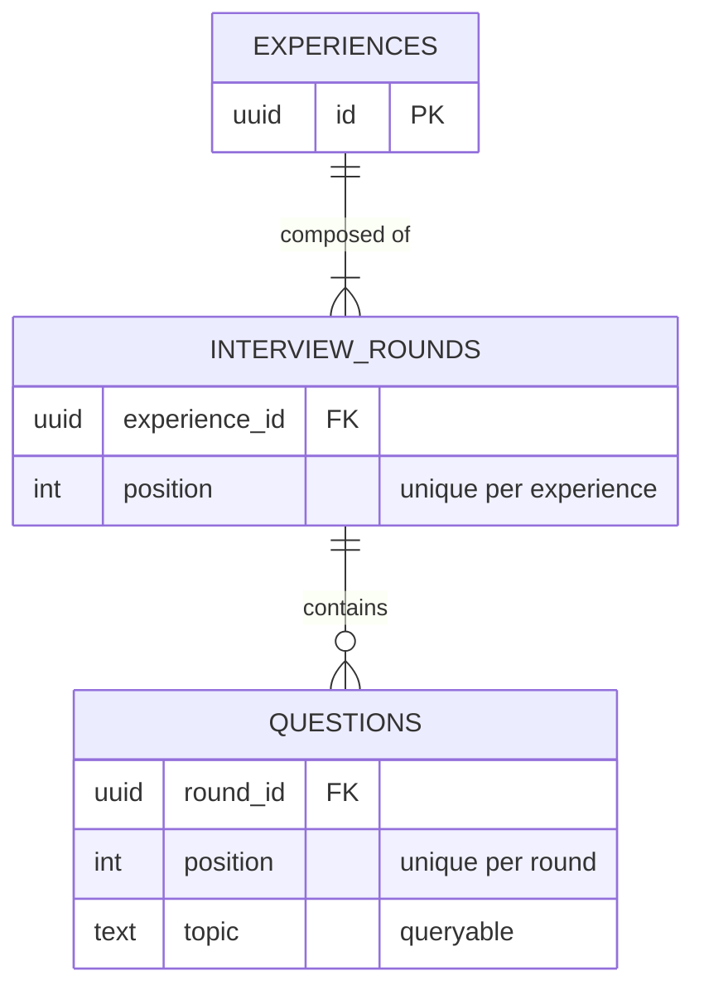


<a id="adr-04"></a>
## ADR-04 Row Level Security plus server-side authorisation (defence in depth)
**Status:** Accepted
- **Problem:** The Supabase anon key is public by design. Anyone can call the database API directly, bypassing our UI and our services.
- **Decision:** RLS enabled on every table as the **last line of defence**; our services also authorise every action on the server. The service-role key is used only in server code for narrowly scoped operations and never reaches the browser.
- **Why:** *Defence in depth* and *least privilege*. A bug in one layer must not become a data leak. Never trust identity or role from the client: the user id comes from the verified session (`auth.uid()`), the role from the database.
- **Rejected:** Only application checks (one missing check exposes everything). Only RLS (hard to express multi-step rules and give good error messages).
- **Cost:** Rules exist twice. Accepted; tests run each rule at both layers.

**Diagram**

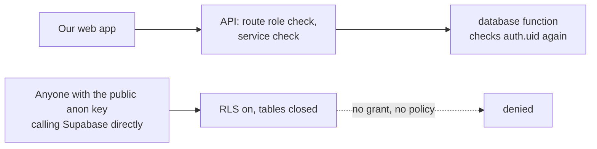


<a id="adr-05"></a>
## ADR-05 Enforce the college email domain in the database
**Status:** Accepted
- **Problem:** A frontend check is trivially bypassed.
- **Decision:** Reject any signup whose email domain is not exactly `nst.rishihood.edu.in`, at the auth boundary (a trigger on `auth.users` or a Supabase "before user created" hook; confirm which at Phase 2). Compare the part after the last `@`, case-insensitively.
- **Why:** *Trust boundary*: validate where untrusted input becomes trusted state. Exact comparison blocks lookalikes such as `x@nst.rishihood.edu.in.evil.com` and `nst.rishihood.edu.in@gmail.com`.
- **Rejected:** Checking only after login in the UI. Using `endsWith` on the whole address string.
- **Cost:** Alumni whose college accounts expire are locked out of posting. Open question recorded in the requirements.

**Diagram**

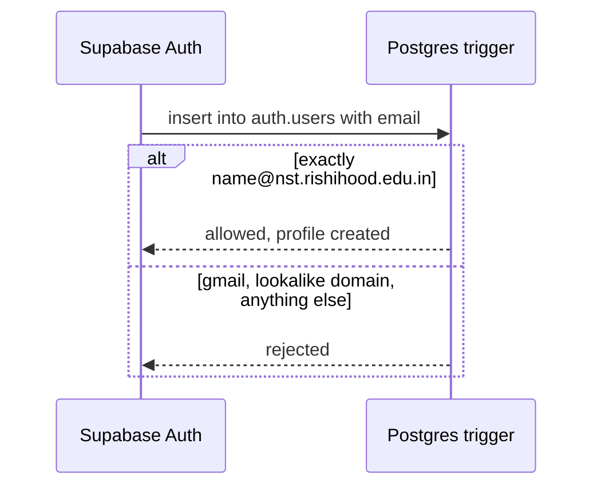


<a id="adr-06"></a>
## ADR-06 Anonymity enforced by the data shape, not the UI
**Status:** Accepted
- **Problem:** "Anonymous · 2027 · CSE" can identify someone in a batch of 60 (a *k-anonymity* failure). Hiding the name in CSS while the API still returns it is not anonymity.
- **Decision:** Public reads go through a public view/function that omits author identity columns, and through `AuthorVisibility` objects in the domain (`IdentifiedAuthor`, `AnonymousAuthor`, `AdminPostedAuthor`) that decide what may be serialised. Anonymous shows batch only, never branch. Author batch and branch are snapshotted on the experience at submit time.
- **Why:** *Privacy by design* and *data minimisation*: the safest field is one that never leaves the server. The snapshot keeps "written by a 2027 student" true even if the profile changes later.
- **Rejected:** A boolean checked in each component (forgotten once, leaks forever).
- **Cost:** Two read paths (public and owner/admin) must be tested separately.

**Diagram**

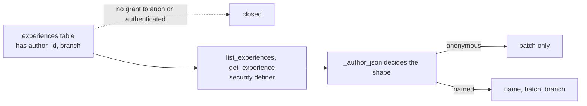


<a id="adr-07"></a>
## ADR-07 Votes and bookmarks as rows with a unique constraint
**Status:** Accepted
- **Problem:** "Look up whether they voted, then insert" is a race: two concurrent taps both see "no vote" and both insert.
- **Decision:** `votes(user_id, experience_id)` with a composite primary key; vote = `INSERT ... ON CONFLICT DO NOTHING`; unvote = `DELETE`. `experiences.upvote_count` is a denormalised counter maintained by a trigger.
- **Why:** *Idempotency* and *constraint over check*: uniqueness is enforced where the write lands. The counter is *denormalisation for reads* (sorting by votes needs no aggregate), with a reconciliation query to detect drift.
- **Rejected:** An `upvotes uuid[]` column on the experience (unbounded, rewrites the row on every vote, leaks voter ids to readers). Counting rows on every read (slow at scale).
- **Cost:** A counter can drift; trigger plus periodic reconcile.

**Diagram**

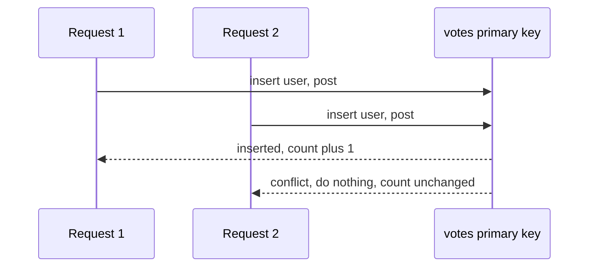


<a id="adr-08"></a>
## ADR-08 Keyset (cursor) pagination
**Status:** Accepted
- **Problem:** Offset pagination re-scans skipped rows and shows duplicates when rows are inserted between pages.
- **Decision:** Cursor encodes the last row's `(created_at, id)`; query uses `WHERE (created_at, id) < ($1, $2) ORDER BY created_at DESC, id DESC LIMIT n+1`. The extra row answers `hasMore`. Matching composite index.
- **Why:** *Stable, O(page) pagination*; the `id` tiebreak makes order total when two rows share a timestamp.
- **Rejected:** `OFFSET` (degrades with depth, unstable under writes).
- **Cost:** No jump-to-page-N. Acceptable for a feed.

**Diagram**

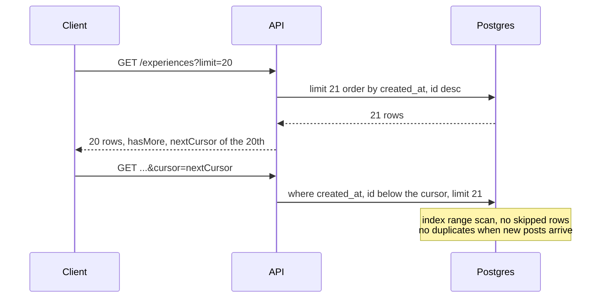


<a id="adr-09"></a>
## ADR-09 Split cacheable public data from per-user state
**Status:** Accepted
- **Problem:** If a cached feed response contains "you have upvoted this", one user's state is served to others.
- **Decision:** Public pages and public read APIs are identical for every caller and cacheable (time-based revalidation plus on-demand tag revalidation when content changes). Per-user state (voted, bookmarked) arrives in a separate non-cached request.
- **Why:** *Cache correctness*: a cacheable response must be a pure function of its URL. Splitting gives the speed of a CDN for the 99% case.
- **Rejected:** One personalised response per request (correct, but no shared caching; slow cold loads).
- **Cost:** Two requests on first paint; the second is small.

**Diagram**

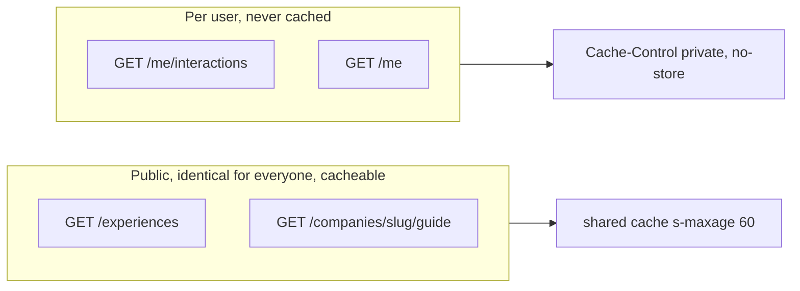


<a id="adr-10"></a>
## ADR-10 Append-only moderation log
**Status:** Accepted
- **Problem:** A `resolved_by` column holds one answer; the next action overwrites the last. You will need to explain a removal one day.
- **Decision:** `moderation_logs` rows are inserted only. RLS grants no UPDATE or DELETE, and a trigger raises an error on either. Company name and role are copied into the row; the post's author is deliberately not.
- **Why:** *Audit trail / immutability* and *event sourcing lite*: history is facts, not state. Copying fields makes the row meaningful after the post is deleted.
- **Rejected:** Status columns on the experience only.
- **Cost:** More rows; trivial at this scale.

**Diagram**

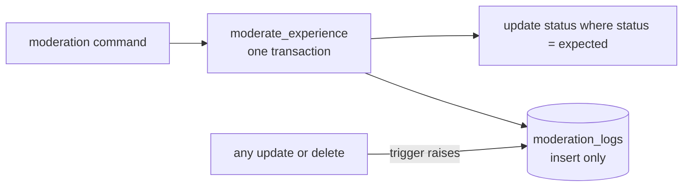


<a id="adr-11"></a>
## ADR-11 Rate limiting stored in Postgres, keyed by user
**Status:** Accepted
- **Problem:** Serverless functions have no shared memory, so in-process limiters reset per instance. IP limits ban a whole campus behind one NAT address.
- **Decision:** A `rate_limits` table and an atomic `check_rate_limit(user, action, limit, window)` function. Limits: submissions 5/day, reports 10/day, votes and bookmarks 60/min, AI guide 20/10 min per user (and a looser per-IP limit for signed-out readers).
- **Why:** *Shared state in a stateless tier*, *fairness* (key on the identity being limited), *abuse protection*. A fixed window allows a 2x burst at the boundary; acceptable here and stated.
- **Rejected:** In-memory counters (do not work across instances). Redis (extra service not justified yet; revisit at the scale-ladder trigger).
- **Cost:** A write per limited request.

**Diagram**

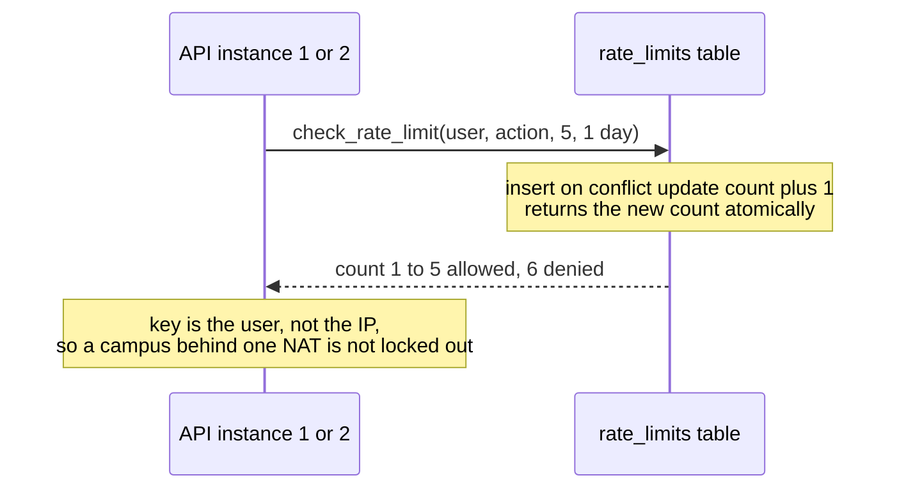


<a id="adr-12"></a>
## ADR-12 AI guide: grounded, cached, and degradable
**Status:** Accepted
- **Problem:** LLM output can hallucinate, quota is limited, and calls are slow.
- **Decision:** Gemini is called server-side with a structured response schema. Every round and tip must cite source experiences by number; citations that do not match a real source are dropped. Counts and top topics are computed in code, never generated. The guide is cached per company with a `fingerprint` (hash of source ids and update times); a changed fingerprint means stale. A `LlmClient` interface lets a decorator add model fallback and timeouts.
- **Why:** *Grounding* (RAG-style) for trust; *cache invalidation by content hash* (no hook in the write path has to remember to invalidate); *graceful degradation* (the archive still works when Gemini is down) and *Decorator* for cross-cutting retries.
- **Rejected:** Generating per page view (cost, latency). Free text output (cannot be rendered as UI or verified).
- **Cost:** Needs enough experiences to be useful; show an honest empty state otherwise.

**Diagram**

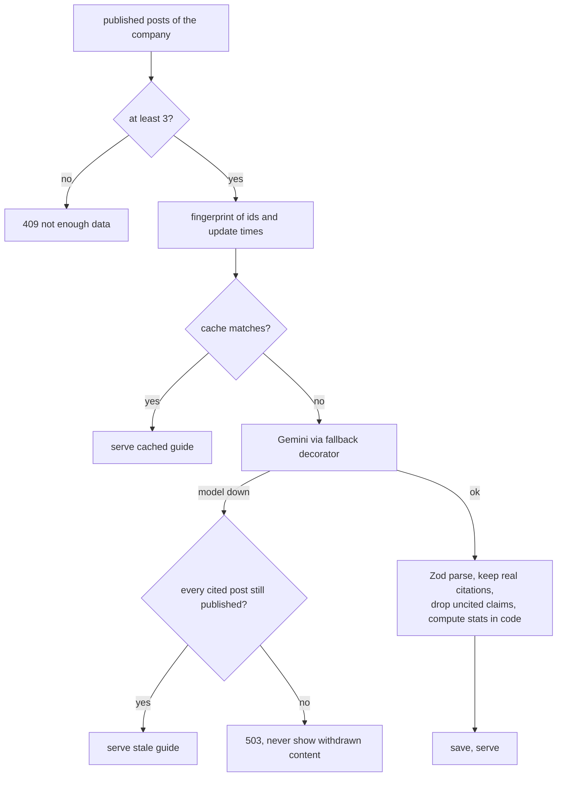


<a id="adr-13"></a>
## ADR-13 Server Components by default for the UI
**Status:** Accepted. **Partly superseded by ADR-21:** mutations are now Express API calls, not Server Actions.
- **Problem:** Client-side fetching delays first paint and hurts search indexing of public pages.
- **Decision:** Data-heavy pages are Server Components fetching from the Express API. Client Components only for interactivity (filters, forms, vote button, animations). Data comes from the Express API (ADR-21): Server Components call it with the viewer's token; client components call it for mutations and load-more.
- **Why:** *Move work to the server*, smaller client bundle, one trust boundary. Public content is SEO-indexable.
- **Rejected:** An SPA with a separate API (two deployables, cross-site cookie complexity).
- **Cost:** Learning curve for caching rules; documented in ADR-09.

**Diagram**

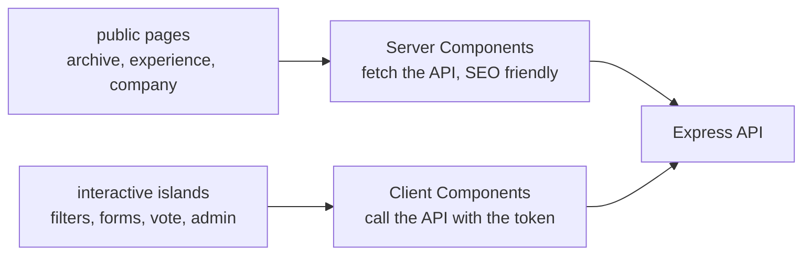


<a id="adr-14"></a>
## ADR-14 Multi-step writes as atomic Postgres functions
**Status:** Accepted
- **Problem:** Submitting an experience writes an experience, rounds, questions and possibly a pending company. `supabase-js` has no multi-statement transaction; a failure midway leaves a half-written post.
- **Decision:** Such writes are Postgres functions called through `rpc`, running in one transaction, with the caller's identity from `auth.uid()`.
- **Why:** *ACID transactions* and *atomicity*: all or nothing. Also keeps author identity server-derived.
- **Rejected:** Several client calls in sequence with manual compensation (non-atomic).
- **Cost:** Logic in SQL for those operations; kept small and tested.

**Diagram**

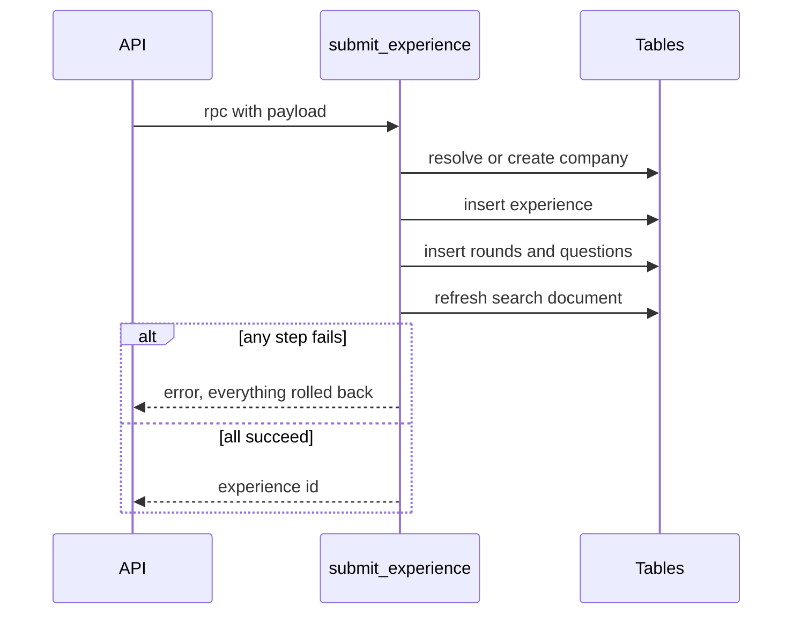


<a id="adr-15"></a>
## ADR-15 Experience lifecycle as an explicit state machine
**Status:** Accepted
- **Problem:** Boolean flags (`is_approved`, `is_deleted`) allow impossible combinations.
- **Decision:** `status` enum: `pending`, `published`, `rejected`, `unpublished`, `removed`. Legal transitions are encoded in the domain (`Experience.publish()`, `.unpublish()` and so on) and checked in the database. Nothing is hard-deleted by an admin. A live edit is stored beside the live content as a pending update, so readers keep seeing the approved version.
- **Why:** *State pattern / finite state machine*: make illegal states unrepresentable. *Soft delete* keeps the audit trail intact.
- **Rejected:** Flags; copy-on-write versions table (more general than needed).
- **Cost:** Transition table must be kept in sync with the diagram (see `06`).

**Diagram**

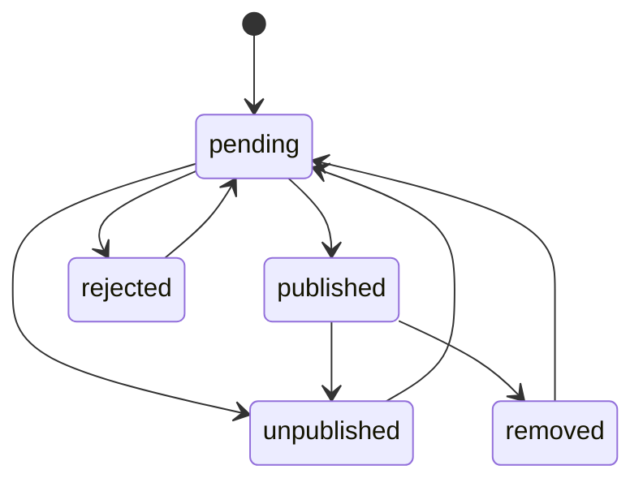


<a id="adr-16"></a>
## ADR-16 Validate with Zod at every boundary, and again in the database
**Status:** Accepted
- **Problem:** Input arrives from forms, URLs, cursors and external LLM output; all untrusted.
- **Decision:** A Zod schema per operation parses input into typed DTOs before any service runs; LLM output is parsed the same way. The database repeats the critical rules as CHECK constraints.
- **Why:** *Fail fast* and *parse, don't validate*: after parsing, the rest of the code deals only with valid types. Two layers because the DB must also survive direct API calls (ADR-04).
- **Rejected:** Validation only in the browser.
- **Cost:** Some duplication between Zod and constraints; shared enums are defined once and imported.

**Diagram**

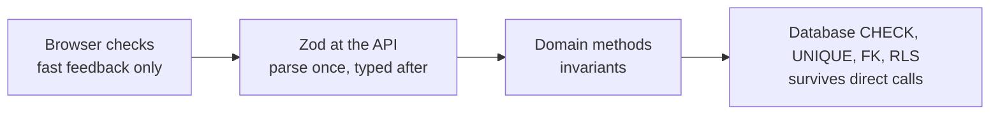


<a id="adr-17"></a>
## ADR-17 Search with Postgres full-text search
**Status:** Accepted
- **Problem:** Users search question text, tips, role and company.
- **Decision:** A generated `tsvector` column with weights (question text highest, then company, role, tips) and a GIN index; `websearch_to_tsquery` for input.
- **Why:** *Use the database you already run* and *choose by scale*: hundreds to thousands of rows do not justify a search cluster. Weighted ranking reflects "a real question matters more than a tip".
- **Rejected:** `ILIKE '%x%'` (cannot use an index, scans the table). External search service (operational cost).
- **Cost:** Weaker typo tolerance; revisit at the scale-ladder trigger.

**Diagram**

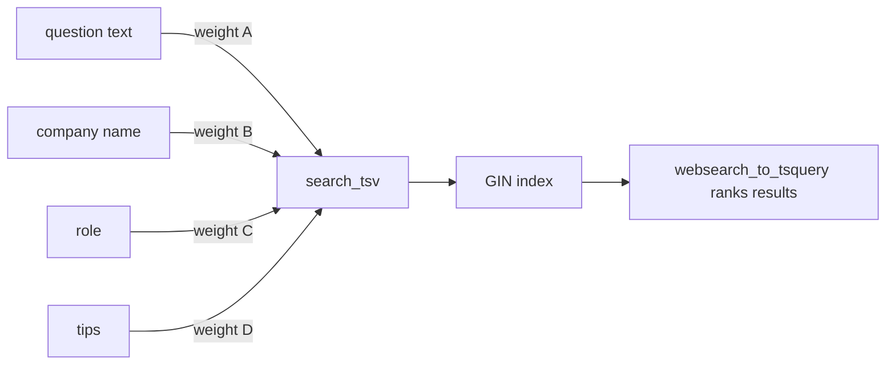


<a id="adr-18"></a>
## ADR-18 Consent is data, enforced by a constraint
**Status:** Accepted
- **Problem:** Publishing a person's rejection story on a Google-indexable URL needs explicit consent. A form checkbox alone is a convention, not a guarantee.
- **Decision:** `consented_at timestamptz` on the experience; `CHECK (status <> 'published' OR consented_at IS NOT NULL)`. The consent sentence sits directly above the submit button.
- **Why:** *Make invariants structural*: no code path (script, migration, future developer) can publish without consent.
- **Rejected:** Controller-only check.
- **Cost:** None meaningful.

**Diagram**

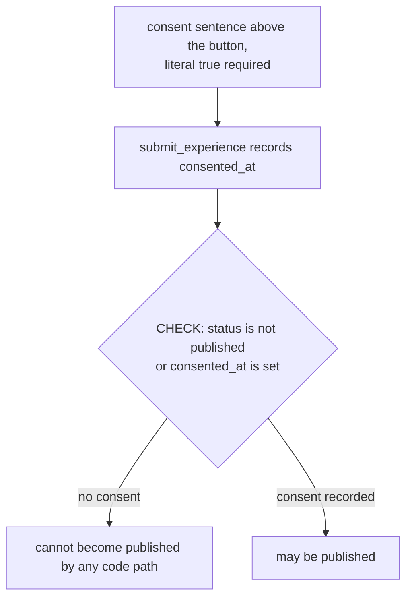


<a id="adr-19"></a>
## ADR-19 One error envelope with a request id
**Status:** Accepted
- **Problem:** Scattered ad hoc error shapes make clients and debugging brittle.
- **Decision:** Domain errors extend `AppError` with a stable `code`, HTTP status and optional per-field errors. One mapper converts any thrown error into `{ error: { code, message, fields? }, requestId }`. Unknown errors become a generic 500 with the detail logged, not returned.
- **Why:** *Consistent contract* and *observability*: a user quotes the `requestId` and you find the exact log line. Not leaking internals is a security requirement.
- **Rejected:** Returning raw database errors.
- **Cost:** Every thrown error must be classified.

**Diagram**

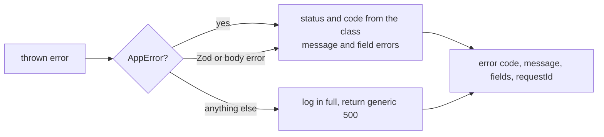


<a id="adr-20"></a>
## ADR-20 Build for current scale; document the ladder
**Status:** Accepted
- **Problem:** Over-engineering for traffic that will not exist wastes the time budget.
- **Decision:** Ship the simple version now with named triggers for the next step.

| Stage | Trigger | Change |
|---|---|---|
| Now (hundreds of users) | Launch | Postgres indexes, cached public pages, Postgres rate limiter |
| Next | p95 latency over target or DB CPU high | Connection pooling tuning, larger Supabase compute, cache detail pages |
| Later | Repeated identical heavy queries | A cache layer for company lists and counters, dedicated search |

- **Why:** *YAGNI with a trigger*: knowing when to scale is the skill; building the last stage first is the mistake.

**Diagram**

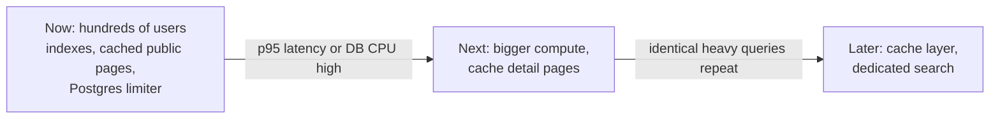


<a id="adr-21"></a>
## ADR-21 A separate Node.js + Express API owns all business logic
**Status:** Accepted (added on owner request)
- **Problem:** The capstone is graded on controller / service / repository separation, SOLID and a defined API. We also need one place for business rules, rate limits and the Gemini key, independent of the UI framework.
- **Decision:** `apps/api` is an Express application written in TypeScript, exposing a versioned REST API (`/api/v1`). `apps/web` (Next.js) is a presentation client of that API only; it holds no business rules and no service-role key. Supabase is used as managed Postgres, Auth and RLS behind the API. Express middleware chain: request id, security headers, CORS (explicit origin), body-size limit, authentication, rate limit, Zod validation, route, central error handler.
- **Why:** *Separation of concerns* and a *single backend as the system of record for rules* (the web app can be replaced or a mobile client added without re-implementing rules). It makes the layered diagram literal: route, controller, service, repository are real folders. *Least privilege:* only the API holds secrets (Gemini key, service-role key).
- **Rejected:** Next.js Route Handlers and Server Actions as the backend (fewer moving parts and one deploy, but the layers blur into the UI framework and the brief asks for an Express backend). Letting the browser talk to Supabase directly for writes (rules would live in RLS and the client).
- **Cost:** Two deployables; an extra network hop for SSR; CORS and token plumbing; cold starts if hosted on a free tier. The hop is acceptable at this scale; hosting is an open question (see below).

**Diagram**

```mermaid
flowchart LR
  W["Next.js web<br/>presentation only"] -->|"Bearer token"| A["Express API<br/>all rules, all secrets"]
  A --> SB[("Supabase<br/>Postgres, Auth, RLS")]
  A --> GM["Gemini"]
```


<a id="adr-22"></a>
## ADR-22 Authentication: Supabase issues the token, the API verifies it
**Status:** Accepted
- **Problem:** The API must know who is calling without trusting anything the client states, and a cross-origin cookie session between two sites is fragile.
- **Decision:** Google sign-in happens through Supabase Auth in the web app. The browser holds the Supabase session; each API call carries `Authorization: Bearer <access token>`. An `authenticate` middleware verifies the token signature and expiry (via the project's JWKS, or `auth.getUser` as a fallback), then loads the profile (role) from the database. Public routes use `optionalAuth`. Role checks use `requireRole('admin')`. The user id and role are never read from the request body.
- **Why:** *Stateless authentication* and *trust boundary*: the signature is the proof, role comes from the database. Bearer tokens avoid `SameSite=None` cross-site cookies and CSRF exposure, because the browser does not attach them automatically.
- **Rejected:** Our own sessions table and Passport (re-implements what Supabase Auth already does). Storing the token in `localStorage` for all pages (an XSS bug would expose it); the web app keeps the session in Supabase's cookie-based SSR helpers and forwards the token from the server or from memory.
- **Cost:** Tokens cannot be revoked before expiry; keep access-token lifetime short and rely on role being re-read from the database on every request.

**Diagram**

```mermaid
sequenceDiagram
  participant W as Web app
  participant A as API
  participant SA as Supabase Auth
  participant DB as Postgres
  W->>A: request with Bearer token
  A->>SA: auth.getUser(token)
  SA-->>A: user id and email, or error
  A->>DB: read own profile as that user (RLS)
  DB-->>A: role from the database
  Note over A: id from the token, role from the DB,<br/>never from the request body
```


<a id="adr-23"></a>
## ADR-23 User-scoped database access by default; service role only for named system tasks
**Status:** Accepted
- **Problem:** If the Express API always uses the service-role key, it bypasses RLS and every authorisation bug becomes a data leak (ADR-04 loses its safety net).
- **Decision:** Repositories receive a Supabase client created per request with the caller's access token, so Postgres evaluates RLS as that user. A separate service-role client exists only in the infrastructure layer and only for operations that must exceed a user's rights: the rate limiter, the AI-guide cache, appending moderation logs inside moderation functions, and scheduled maintenance. Each use is listed in `docs/design/08-database-schema.md`.
- **Why:** *Least privilege* and *defence in depth*: an application bug stays bounded by RLS. The service-role key is a master key; its use is an audited, short list.
- **Rejected:** Service role everywhere (simple, no RLS protection). Raw `pg` pool with `SET LOCAL role` (more control, more to get wrong).
- **Cost:** A client object per request; some operations need security-definer functions. Accepted.

**Diagram**

```mermaid
flowchart LR
  REQ["each request"] --> UC["user-scoped client<br/>carries this user's token<br/>RLS and auth.uid apply"]
  SYS["system tasks only"] --> SR["service-role client"]
  SR --> L1["rate limiter"]
  SR --> L2["guide cache"]
  SR --> L3["account deletion"]
```


<a id="adr-24"></a>
## ADR-24 Monorepo with one shared contract package
**Status:** Accepted (ASSUMPTION: npm workspaces; confirm tooling at setup)
- **Problem:** The web app and API must agree on request and response shapes, enums and error codes, or they drift.
- **Decision:** `packages/shared` holds Zod schemas, enums, DTO types and error codes. The API validates with them; the web app uses the same inferred types for forms and responses.
- **Why:** *Single source of truth* for the contract (DRY) and compile-time detection of drift.
- **Rejected:** Duplicated types in each app; code generation from OpenAPI (heavier than needed now).
- **Cost:** Workspace setup and a build step for the shared package.

**Diagram**

```mermaid
flowchart TB
  SH["packages/shared<br/>Zod schemas, enums, types, error codes"] --> API["apps/api"]
  SH --> WEB["apps/web"]
```


<a id="adr-25"></a>
## ADR-25 Reads and writes go through security-definer functions; tables stay closed
**Status:** Accepted (built in migrations 0003 and 0004)
- **Problem:** The Supabase anon key is public and the API is reachable directly. A column such as `author_branch` on a readable table leaks anonymity no matter what the UI hides.
- **Decision:** Experience-related tables have RLS enabled with no policy and no grant to `anon` or `authenticated`. The API calls narrowly scoped `SECURITY DEFINER` functions that check `auth.uid()` themselves, set `search_path = ''`, and return only safe columns. EXECUTE is revoked from everyone, then granted to the exact roles that need each function.
- **Why:** *Least privilege* and *privacy by construction*: the only way to read an experience is a function that applies the anonymity rule. *Single enforcement point* for each business rule (moderation, voting).
- **Rejected:** Views (run as owner, same exposure, advisor warning); column-level grants plus policies (cannot express the anonymity rule and the owner/admin exceptions cleanly).
- **Cost:** Logic in SQL; the advisor lists the intended functions as warnings, which are documented and accepted. Every function needs a test (see `08` §8.7).

**Diagram**

```mermaid
flowchart LR
  APP["API or anyone with the anon key"] -- "select, insert, update" --> TB["experiences, votes, reports...<br/>RLS on, no policy, no grant"]
  APP -- "rpc" --> FN["security definer functions<br/>check auth.uid, return only safe columns"]
  FN --> TB
  EX["EXECUTE revoked from everyone,<br/>then granted per function"] -.-> FN
```

---

<a id="adr-26"></a>
## ADR-26 Named test accounts beside the college-domain rule
**Status:** Accepted (owner request, 2026-11-10; amends ADR-05)

**Problem.** The student side must be tested with a non-college Google account, but ADR-05 rejects every address outside `@nst.rishihood.edu.in`.

**Decision.** The rule stays the default. The sign-up trigger `enforce_college_domain` now accepts an address if it matches the college domain exactly **or** is listed in the closed table `allowed_test_emails` (migration 0011, test `supabase/tests/006_test_email_allowlist.sql`). The table has RLS on and no grant, so it can be changed only by a migration or the SQL editor. A listed address becomes a normal `student` (admin still comes only from `admin_emails`). Currently listed: two test addresses (migrations 0011 and 0012).

**Why (concept).** *Least privilege and allowlisting*: open one named door instead of removing the wall. The check stays in the database (defence in depth, ADR-25), so it holds for any client.

**Rejected.** Removing the domain rule: any Google account could sign in and post, breaking the college-only guarantee. Putting the list in an environment variable of the API: sign-up happens in Supabase Auth, before the API is involved, so only the database can enforce it.

**Trade-off.** An allowlisted address bypasses the college check, so remove it (delete the row in a migration) before a real launch.

**Diagram**

```mermaid
flowchart TD
  SU["insert into auth.users with email"] --> A{"exactly name@nst.rishihood.edu.in ?"}
  A -- yes --> OK["allowed, profile created"]
  A -- no --> B{"listed in allowed_test_emails ?"}
  B -- yes --> OK
  B -- no --> NO["rejected by the trigger"]
```

## ADR-27 The API is written in JavaScript; the shared contract stays TypeScript

**Problem.** The owner wants the backend in plain JavaScript. The API was first built in TypeScript, and the web app and API share one contract package.

**Decision.** `apps/api` is ES-module JavaScript (Node 22, `.js` files, no build step, `node --watch` for dev). Ports (the interfaces in `domain/ports.js`) become JSDoc `@typedef`s. `packages/shared` stays TypeScript and is built to `dist`, so the web app keeps its types and the API imports the compiled Zod schemas.

**Why.** Dependency Inversion and Interface Segregation do not need a compiler: the ports are still the only thing services know about, now documented as typedefs and enforced by the fake adapters in tests. Runtime validation at every boundary is Zod (shared), so the safety that matters at the edge does not come from static types. One contract package keeps the web and API from drifting (ADR-24).

**Rejected.** (1) Converting `packages/shared` too: the web app would lose types for every API response. (2) Keeping TS with `allowJs`: no benefit over the status quo. Trade-off accepted: renames and signature changes in the API are no longer caught by `tsc`; the 94 tests and the Zod schemas are the safety net.

## ADR-28 Web UI follows the owner's Stitch design, built from tokens, primitives and lookup tables

**Problem.** The first frontend was an art-directed cinematic site that students could not read: too many sections, unclear labels. The owner designed the real screens in Google Stitch (project `3022551661059433556`: Home, Sign in, Experiences, Experience detail, Share your interview, My posts, Profile, Admin moderation) and asked for the app to be rebuilt from them.

**Decision.** (1) **Design tokens** in one place: the Stitch palette, Public Sans and radii live in `globals.css` under `@theme`; components use names (`bg-primary`), never hex. (2) **UI primitives** in `components/ui/` (Icon, Button, Badge, Notice, Tabs, Segmented, EmptyState) and **layout components** (`PageShell`, `AppHeader`, `AppFooter`); pages only compose them. (3) **Lookup tables instead of conditionals** for look: `VARIANT` (Button), `TONE` (Badge), `OUTCOME_TONE` and `STATUS_TONE` (`lib/format.ts`), `PANELS` (`AdminConsole`). (4) One `useMe()` hook for the signed-in profile. (5) Presentational components (`ExperienceCard`, `ExperienceView`) take data as props and never fetch. (6) Every component that copies a Stitch screen says so in a `Design source:` comment, including what was dropped and why.

**Why.** Single source of truth for design values; Single Responsibility (frame, content, data are separate); Open/Closed (a new outcome, status, button look or admin tool is one table entry); Dependency Inversion (components depend on `useMe` and `api`, not on URLs and `fetch`); DRY (the profile fetch existed in five components).

**Rejected.** (a) Pasting the Stitch HTML as-is: no reuse, no accessibility pass, fake data baked in. (b) A component library (shadcn, MUI): extra dependency for eight screens. (c) A repository or service class layer in the web app: the API already is that layer (ADR-21); a second one would be indirection with no problem to solve.

**Deliberate differences from the mock.** Anything with no real data behind it is left out, following the rule of no fake numbers: archive count and "page 1 of 11", difficulty, per-round duration and platform, view counts, "peer impact", admin "automated privacy check", author photos. The mock's right-hand admin column became tabs. The earlier rule "no violet" in CLAUDE.md section 8 is superseded: the owner's palette is violet.

## ADR-29 Re-theme the web UI to the Rishihood University brand

**Problem.** PrepLens is for NST students at Rishihood University, but the Stitch palette (violet, Public Sans) had no connection to the institution. The owner asked for a premium look in the university's own identity, using its logos and campus imagery.

**Decision.** (1) **Re-theme through the tokens only.** The token *names* from ADR-28 stay; their *values* in `globals.css` change to the university brand taken from rishihood.edu.in: crimson `#D00736` (primary, slightly deepened to `#C8072F` for contrast), maroon for depth, terracotta `#D7815D` as the accent, cream and sand surfaces. Three new tokens (`maroon`, `maroon-deep`, `gold`) cover the dark bands. (2) **Type follows the university pairing**: EB Garamond for display headings (`h1`, `.font-display`), Montserrat for the interface. (3) **Brand assets live locally** in `apps/web/public/brand/` (colour and white university logos, the NST logo, the campus line drawing, five campus photographs converted to WebP) and are rendered by `components/brand/Brand.tsx` (`PrepLensMark`, `Wordmark`, `RishihoodLogo`, `NstLogo`). (4) The high-visibility surfaces were redrawn on top of the tokens: home (campus hero, live archive, how it works, promises, closing call), header, footer, page heading band (`PageShell`), sign-in (split screen), experience card, experience detail timeline, company header, and the AI guide panel (whose inner classes were previously unstyled). (5) The footer states that PrepLens is an independent student project, not an official university service.

**Why.** Single source of truth for design values: because ADR-28 put every value behind a token, a full re-brand touched one block of CSS and every screen followed, including the admin, profile and submit screens that were not redrawn (Open/Closed at the design level). Assets are served from our origin, not hot-linked, so the site does not depend on the university's CDN and pays no third-party request cost.

**Rejected.** (a) Hot-linking images from rishihood.edu.in: breaks if their site changes, and leaks every visitor's request to a third party. (b) Copying the university site's layout: the product is an archive, not a prospectus; only the identity is borrowed. (c) A new component library for the "premium" feel: the existing primitives already carry it once the tokens change.

**Rules kept.** No invented numbers: the home page counts (experiences published, companies covered) are computed from the API response, and the section hides itself if the API is unreachable. Anonymous authors still render as `Anonymous · <batch>`. The consent sentence still sits directly above the submit button. **Open item:** the university logos and photographs belong to Rishihood University; written permission is needed before a public launch.
