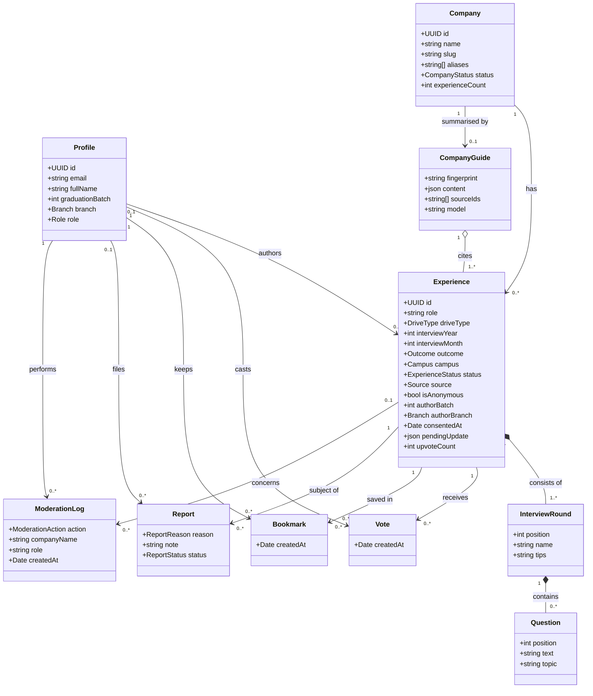
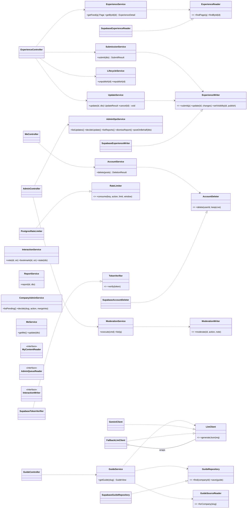

# 3. Class Diagrams

**Status: matches the code (rewritten 2026-11-10; see the decision below).** Notation: `*--` composition, `o--` aggregation, `-->` association, `<|--` inheritance, `<|..` realisation, `..>` dependency.

## 3.0 The decision: where do the "entities" live?

The first draft drew `Profile`, `Experience`, `Company` and the rest as TypeScript classes with behaviour. We did **not** build them that way, on purpose (ADR-25): the rules that protect the data (consent, anonymity, legal status changes, one vote per user, append-only log) must hold even when the API is bypassed, so they live in the database. A TypeScript copy would be a second source of truth that can drift.

Resolution, in two parts:

1. **Diagram A is the entity model as the database implements it.** The tables, keys and relationships are the entities. The multiplicities and the composition and aggregation reasoning from the first draft still hold and are kept.
2. **Diagram C is the TypeScript domain model, and every class in it is used by running code and covered by tests.** Where behaviour has to exist in TypeScript (what a viewer may do next, how to resume a paged list, what an author looks like on the wire), we wrote real classes: `ExperienceLifecycle`, `FeedSort`, `AuthorVisibility`. Where the database already enforces the rule, the TypeScript class describes it and a test proves the two agree (`model.test.ts` reads the SQL and compares the transition table).

## A. Entity model (database tables)

| Relationship | Multiplicity | Why |
|---|---|---|
| Profile to Experience | 0..1 to 0..\* | Author is nullable: after account deletion with "keep", the post survives detached; admin-posted posts have no profile |
| Company to Experience | 1 to 0..\* | Every experience belongs to one company; deleting a company with posts is refused (`ON DELETE RESTRICT`) |
| Experience to InterviewRound | 1 to 1..\* composition | A round has no meaning outside its experience (`ON DELETE CASCADE`); submit requires 1 to 12 rounds |
| InterviewRound to Question | 1 to 0..\* composition | Same reasoning |
| Vote / Bookmark | association with composite primary key | The key is the rule "one per user per experience" |
| ModerationLog to Experience | 0..1 | The log must outlive a deleted post, so the link is optional and the row copies company name and role |
| CompanyGuide to Experience | aggregation | The guide cites posts but does not own them |

## B. Layers, services and ports (application layer)

Services depend only on the interfaces. The `Supabase*`, `Gemini*` and `Postgres*` classes live in `infrastructure/` and are wired in `container.ts`, the only file that names them.

## C. TypeScript domain model (hierarchies and entities with behaviour)

```mermaid
classDiagram
direction TB

class Submission {
  <<abstract>>
  +toPayload() SubmitPayload
  #normaliseRounds()* RoundPayload[]
  #validateSpecific() void
}
class QuickSubmission
class DetailedSubmission
Submission <|-- QuickSubmission
Submission <|-- DetailedSubmission
class SubmissionFactory { +create(dto) Submission }
SubmissionFactory ..> Submission

class FeedSort {
  <<abstract>>
  +name FeedSortName
  +nextCursor(card) string
  +after(cursor) FeedAfter
  #keyOf(card)* string
  #resume(key, id)* FeedAfter
}
class NewestFirst
class InterviewDateFirst
FeedSort <|-- NewestFirst
FeedSort <|-- InterviewDateFirst

class AuthorVisibility { <<abstract>> +toPublic()* PublicAuthor }
class AnonymousAuthor
class NamedAuthor
AuthorVisibility <|-- AnonymousAuthor
AuthorVisibility <|-- NamedAuthor
class AuthorVisibilityFactory { +fromDb(raw) AuthorVisibility }

class ExperienceLifecycle {
  +TRANSITIONS
  +canMove(from, to) bool
  +actionsFor(ctx) ExperienceAction[]
}

class ModerationCommand { <<interface>> +action +experienceId +run(writer) }
class ApproveCommand
class RejectCommand
class RemoveCommand
class ReinstateCommand
ModerationCommand <|.. ApproveCommand
ModerationCommand <|.. RejectCommand
ModerationCommand <|.. RemoveCommand
ModerationCommand <|.. ReinstateCommand
class ModerationCommandFactory { +create(action, id, note) ModerationCommand }

class CompanyGuide {
  +fingerprint
  +sourceIds
  +isStale(fp) bool
  +citesOnly(ids) bool
  +toView(company, stale) GuideView
}

class AppError {
  <<abstract>>
  +code
  +httpStatus
  +fields
}
class ValidationError
class AuthenticationError
class ForbiddenError
class NotFoundError
class ConflictError
class RateLimitedError
class NotEnoughDataError
class UpstreamError
AppError <|-- ValidationError
AppError <|-- AuthenticationError
AppError <|-- ForbiddenError
AppError <|-- NotFoundError
AppError <|-- ConflictError
AppError <|-- RateLimitedError
AppError <|-- NotEnoughDataError
AppError <|-- UpstreamError
```

What each hierarchy removes (each is used by running code and tested):

| Hierarchy | The conditional it replaces | Where used | Test |
|---|---|---|---|
| `Submission` | `if (mode === 'quick')` repeated in controller, service, tests | `SubmissionService`, `AdminOpsService.postOnBehalf` | `writes.test.ts`, `features.test.ts` |
| `FeedSort` | A growing `switch (sort)` in the service and the cursor code | `ExperienceService.getFeed` | `model.test.ts` (cursor round trip, cross-sort rejection) and a live paged run of both orders |
| `AuthorVisibility` | `if (isAnonymous)` in the mapper | `toCard`, `toDetail` | `units.test.ts` and `model.test.ts` (fail closed, extra fields cannot leak) |
| `ExperienceLifecycle` | Status checks scattered through the UI | `ExperienceService.getById` adds `allowedActions`; the experience page draws its buttons from it | `model.test.ts`, including a test that reads the SQL trigger and compares the transition table |
| `ModerationCommand` | One `moderate(action, …)` with a switch and a forgettable log write | `ModerationService.execute`, `AdminController.moderate` | `writes.test.ts` |
| `AppError` | Ad hoc error shapes | The error handler, every service | every route test |

Not built, and why: separate `Experience`, `Profile`, `Vote` classes (the database is the entity model, see 3.0); a class per report or per round (data only, no behaviour).
