# 5. Design Patterns

Rule: **a pattern is justified by the problem it solves here, not by its name.** Every pattern below is in running code, has a test, and has a diagram. The patterns we considered and rejected come last, with the reason. All other diagrams are in the root [`README.md`](../../README.md).

| # | Pattern | Category | Class | Why it earns its place |
|---|---|---|---|---|
| 1 | Ports and adapters (layering) | Architectural | `domain/ports.ts`, `infrastructure/` | Rules independent of Supabase, Express and Gemini |
| 2 | Repository | Structural | `Supabase*Reader`, `Supabase*Writer` | One home for persistence knowledge |
| 3 | Adapter | Structural | `GeminiClient`, `SupabaseTokenVerifier` | Vendor shapes stop at one class |
| 4 | Decorator | Structural | `FallbackLlmClient` | Resilience without changing callers |
| 5 | Factory | Creational | `SubmissionFactory`, `ModerationCommandFactory`, `SupabaseRepositoryFactory`, `AuthorVisibilityFactory` | Callers never name the concrete class |
| 6 | Composition root | Creational | `container.ts` | Dependency inversion in one file |
| 7 | Template Method | Behavioural | `Submission`, `FeedSort` | Fixed algorithm, one varying step |
| 8 | Strategy | Behavioural | `FeedSort` | Interchangeable orderings |
| 9 | Command | Behavioural | `ModerationCommand` family | Each decision is an object |
| 10 | State | Behavioural | `ExperienceLifecycle` plus the DB trigger | Illegal states are unrepresentable |
| 11 | Polymorphism instead of a flag | Behavioural | `AuthorVisibility` | One output gate for privacy |

---

## 1. Ports and adapters (layered architecture)

- **Problem:** Next.js and Express make it easy to put queries inside handlers. Then rules are scattered and untestable.
- **Decision:** Services depend only on interfaces (ports) in the domain. Concrete classes for Supabase, Gemini and Postgres implement them in `infrastructure/`.
- **Why (concept):** *Dependency Inversion* and *separation of concerns*. The 116 API tests run services against in-memory fakes, with no database.
- **Where:** `apps/api/src/domain/ports.ts`, `infrastructure/`, `container.ts`.

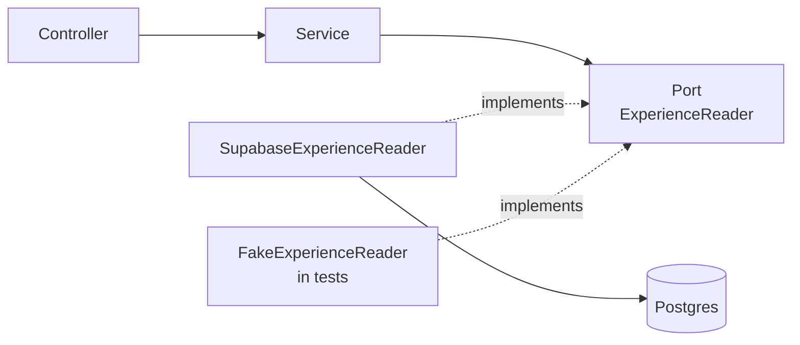

## 2. Repository

- **Problem:** SQL and RPC names spread through services make every change a hunt.
- **Decision:** All persistence knowledge for one concern lives in one class behind a port. Errors from the database are translated once (`fromDbError`).
- **Why:** *Encapsulation* of storage. Services stay about business flow.
- **Where:** `infrastructure/supabase/SupabaseExperienceReader.ts`, `SupabaseReaders.ts` (list reads), `SupabaseWriters.ts`, `SupabaseAdminWriters.ts`.

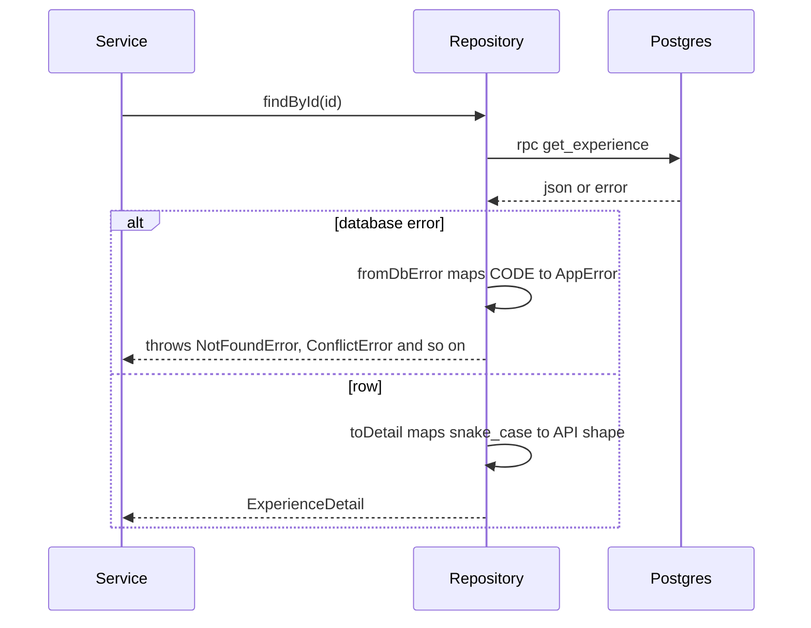

## 3. Adapter

- **Problem:** Gemini's request and response shapes (and a vendor's error text) must not leak into business code or to clients.
- **Decision:** `GeminiClient` implements our `LlmClient` port and translates both ways. Vendor error wording is kept in a `detail` field for logs; the client-facing message is generic.
- **Why:** *Anti-corruption boundary*. Swapping vendors touches one class. Found in a live run: the vendor message "API key not valid" was reaching clients before this was fixed.
- **Where:** `infrastructure/llm/GeminiClient.ts`, `infrastructure/supabase/SupabaseTokenVerifier.ts`.

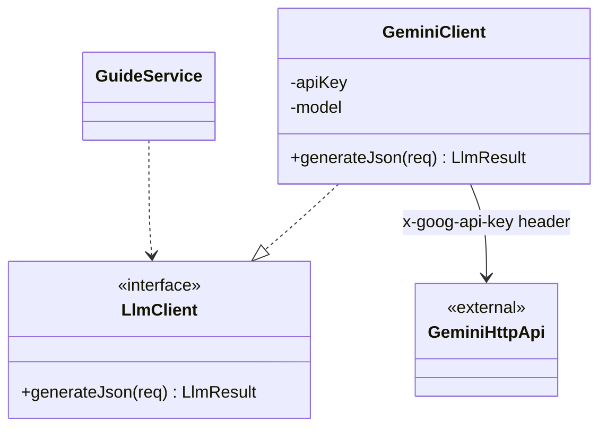

## 4. Decorator

- **Problem:** Free-tier models are overloaded (429, 5xx) or renamed (404). Retry code copied into every caller would be wrong in at least one.
- **Decision:** `FallbackLlmClient` wraps several `LlmClient`s and tries them in order. Only transient statuses move on; a malformed request (400) fails the same everywhere and is not retried.
- **Why:** *Open/Closed* and *Liskov*: `GuideService` cannot tell the decorator from a single client.
- **Where:** `infrastructure/llm/FallbackLlmClient.ts`; tested in `guide.test.ts` (retired model, busy model, all busy).

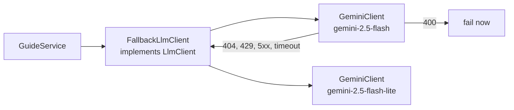

## 5. Factory

- **Problem:** Callers should not know which concrete class applies, and an `if (mode === ...)` repeated in several places drifts.
- **Decision:** Four small factories: `SubmissionFactory` (quick or detailed), `ModerationCommandFactory` (which decision), `SupabaseRepositoryFactory` (repositories for this caller, anonymous or one user), `AuthorVisibilityFactory` (anonymous or named from raw data, failing closed).
- **Why:** *Single point of creation*; the choice is made once.
- **Where:** `domain/Submission.ts`, `domain/ModerationCommand.ts`, `infrastructure/SupabaseRepositoryFactory.ts`, `domain/model/AuthorVisibility.ts`.

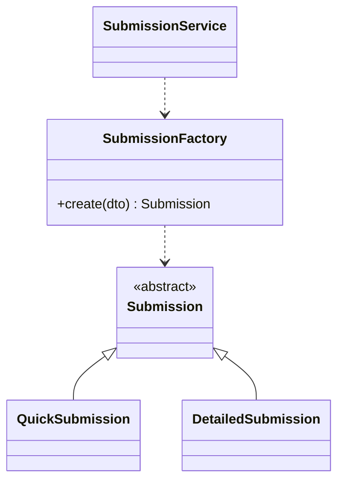

## 6. Composition root

- **Problem:** Singletons and globals hide dependencies and make testing hard.
- **Decision:** `container.ts` is the only file that names concrete classes. It builds per-request services from a per-request user-scoped repository set plus a few shared collaborators.
- **Why:** *Dependency Inversion*, explicit wiring. Tests build the same `Container` with fakes.
- **Where:** `apps/api/src/container.ts`.

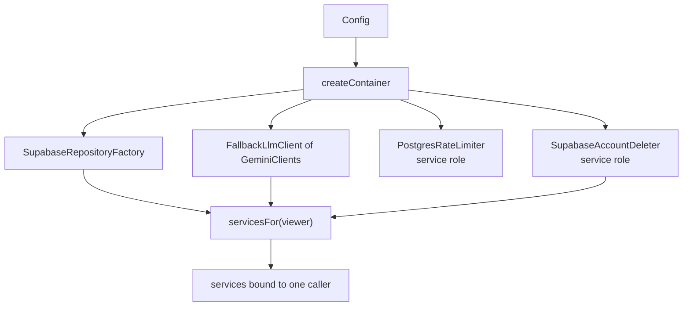

## 7. Template Method

- **Problem:** Two ways to write the same thing (quick note, round by round) share all steps except how rounds are produced. Cursor handling is shared by every sort order except the key.
- **Decision:** The base class fixes the algorithm; subclasses fill in one step. `Submission.toPayload()` validates, normalises rounds, builds the payload. `FeedSort.nextCursor` and `after` handle encoding, tamper checks and the sort name; subclasses supply `keyOf` and `resume`.
- **Why:** *Inheritance used for a genuine shared skeleton*, not for reuse alone.
- **Where:** `domain/Submission.ts`, `domain/model/FeedSort.ts`.

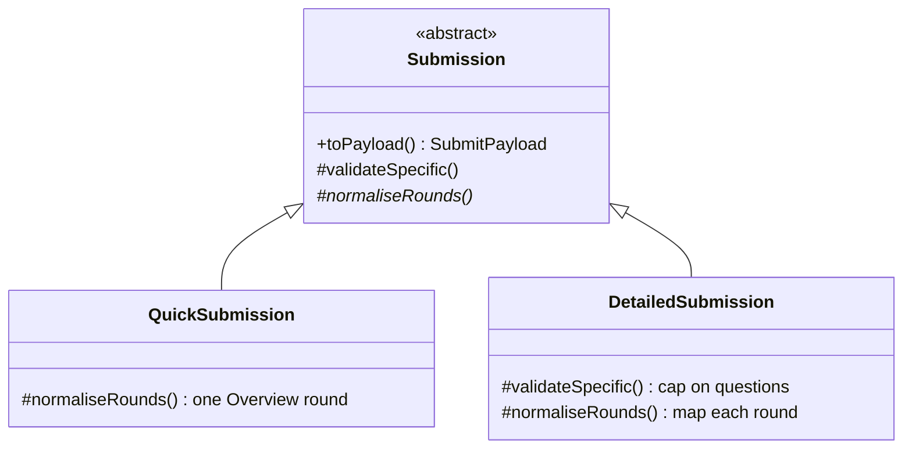

## 8. Strategy

- **Problem:** The archive can be ordered by when it was shared or by when the interview happened. Each needs its own sort key and its own way to resume a page.
- **Decision:** `FeedSort` is the strategy interface with `NewestFirst` and `InterviewDateFirst`. The service asks the factory for one by name. A cursor carries its sort name, so a cursor from one order under another is rejected.
- **Why:** *Open/Closed*: a third ordering is a subclass and one SQL branch. A new user-visible feature (Sort by) came out of it.
- **Where:** `domain/model/FeedSort.ts`; migration `0010_feed_sort.sql`; `model.test.ts`; verified live paging both orders.

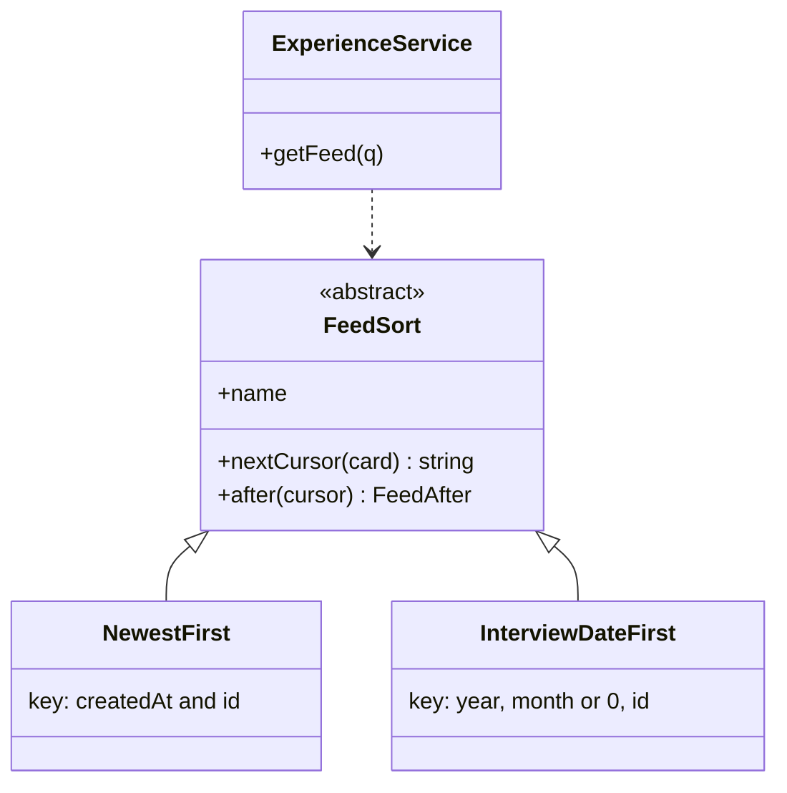

## 9. Command

- **Problem:** One `moderate(action, ...)` with a switch lets a new decision forget the audit log.
- **Decision:** Each decision is an object (`Approve`, `Reject`, `Remove`, `Reinstate`) that knows its action and runs itself. `RejectCommand` refuses a missing note before touching the database. The database writes the log row in the same transaction.
- **Why:** *Open/Closed* and *single responsibility*: a new decision is a new class and `ModerationService` does not change.
- **Where:** `domain/ModerationCommand.ts`, `services/ModerationService.ts`; `writes.test.ts`.

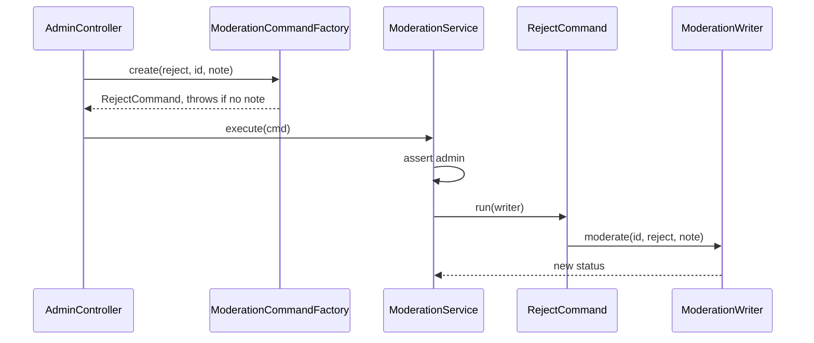

## 10. State

- **Problem:** Boolean flags (`is_approved`, `is_deleted`) allow impossible combinations.
- **Decision:** Status is an enum with an explicit transition table, enforced by a database trigger. `ExperienceLifecycle` describes the same table in TypeScript and also computes what a viewer may do next. A test reads the SQL and fails if the two tables differ.
- **Why:** *Make illegal states unrepresentable*; one description used by both the guard and the user interface.
- **Where:** `domain/model/ExperienceLifecycle.ts`, `guard_experience` in `0006_guard_ignores_search_index.sql`; `model.test.ts`.

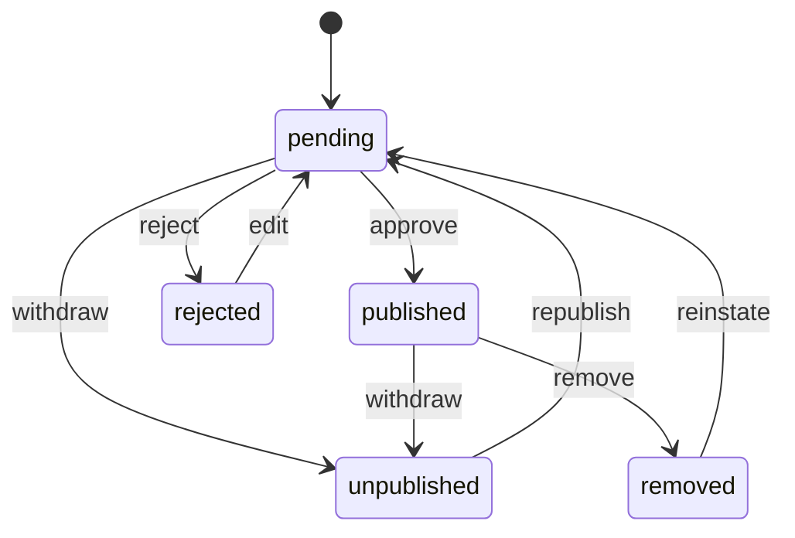

## 11. Polymorphism instead of a flag (output gate)

- **Problem:** `if (isAnonymous) hide(branch)` scattered across mappers leaks the one time it is forgotten. A k-anonymity failure (batch plus branch) can identify a person.
- **Decision:** `AuthorVisibility` with `AnonymousAuthor` and `NamedAuthor`. The factory fails closed: anything not explicitly `anonymous: false` is anonymous. An anonymous author can only serialise to `{ anonymous, batch }`, whatever else arrives. The database also decides what to return, so this is a second gate.
- **Why:** *Defence in depth* and *privacy by design*.
- **Where:** `domain/model/AuthorVisibility.ts`; `units.test.ts` and `model.test.ts`.

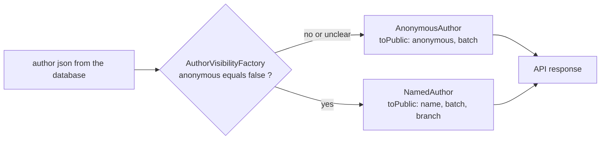

---

## Considered and rejected

| Pattern | Why not |
|---|---|
| **Singleton** (shared database client) | The user-scoped Supabase client carries one user's token. A shared instance would run one user's queries as another. Module-level config is plain module scope, not a claim of the pattern |
| **Observer** (events and subscribers) | No feature needs in-process fan-out. Guide staleness uses a content fingerprint, counters use database triggers, and the audit row is written by the command inside the same transaction. An in-process emitter also loses events on a serverless restart |
| **Builder** | The database function assembles an experience from one JSON payload; a step-by-step builder would add ceremony with no second caller |
| **Chain of Responsibility** | Express middleware is exactly this. We use it (authenticate, role, rate limit, validate) but did not design it, so we do not claim it. See the request pipeline diagram in the README |
| **Abstract Factory, Visitor, Mediator, Flyweight** | No problem here that they would solve |

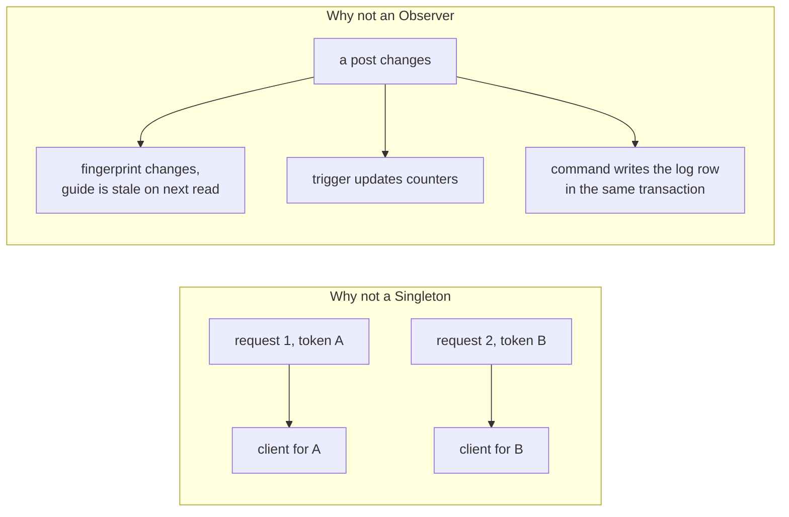

## Evidence for each pattern

| Pattern | Test or proof |
|---|---|
| Ports and adapters | All 116 API tests run with fakes |
| Repository, Adapter | `units.test.ts` mapper tests; `guide.test.ts` adapter tests (key in header, malformed JSON, status mapping) |
| Decorator | `guide.test.ts` fallback tests; a live run with a bad key |
| Factory, Template Method | `writes.test.ts` design-classes tests |
| Strategy | `model.test.ts`; a live paged run of both orders |
| Command | `writes.test.ts` moderation tests |
| State | `model.test.ts` including SQL parity |
| Polymorphism (author) | `units.test.ts`, `model.test.ts` |
