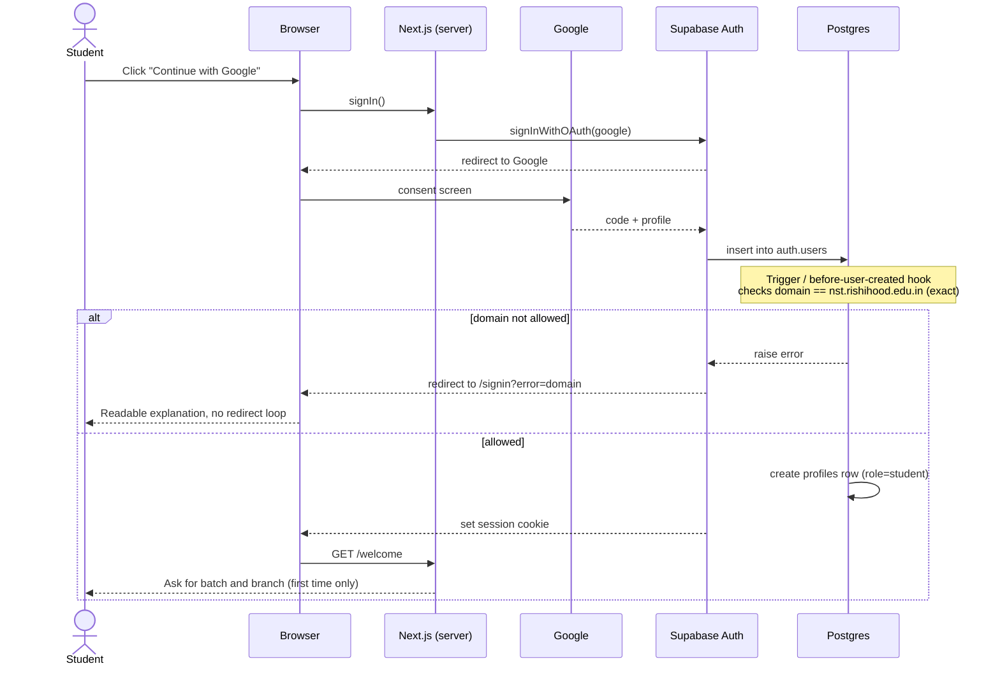
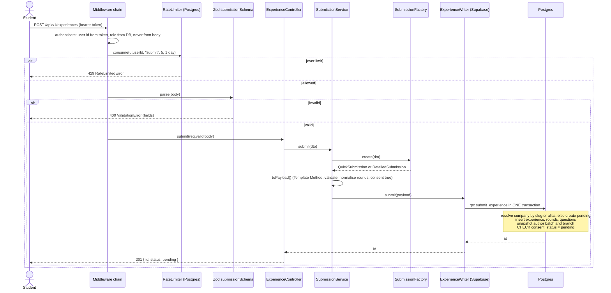
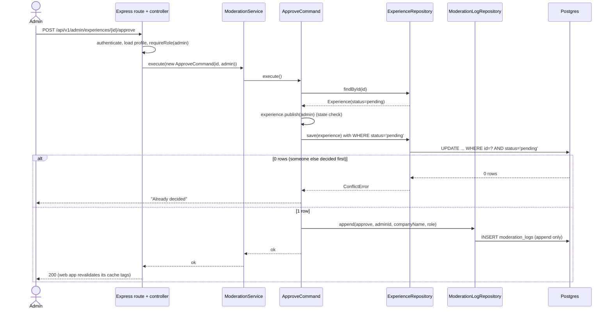
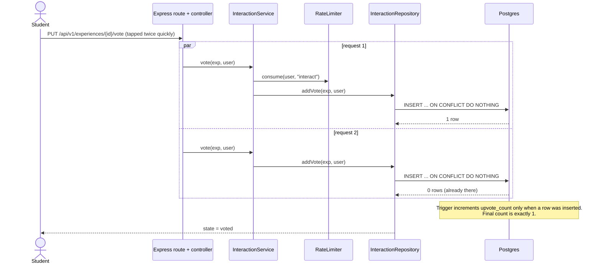
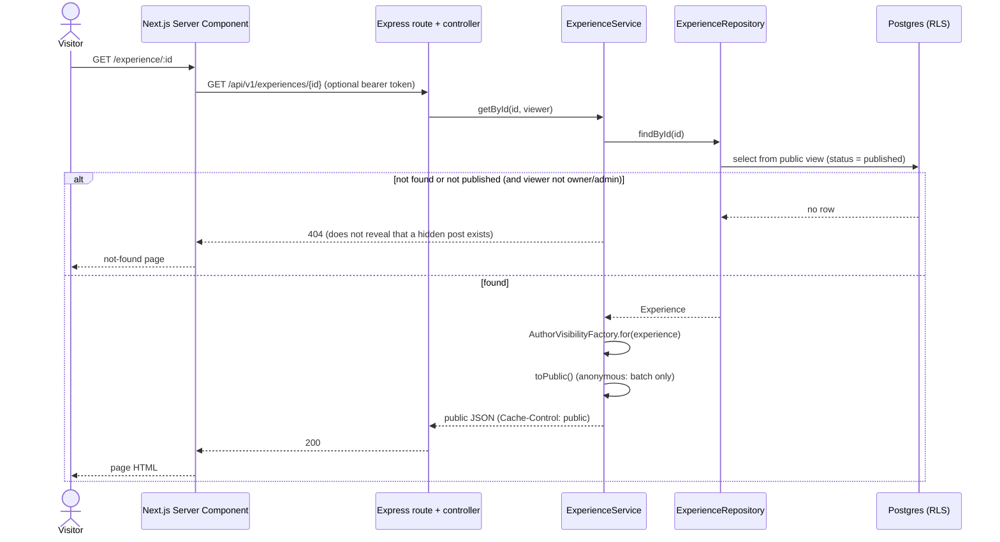
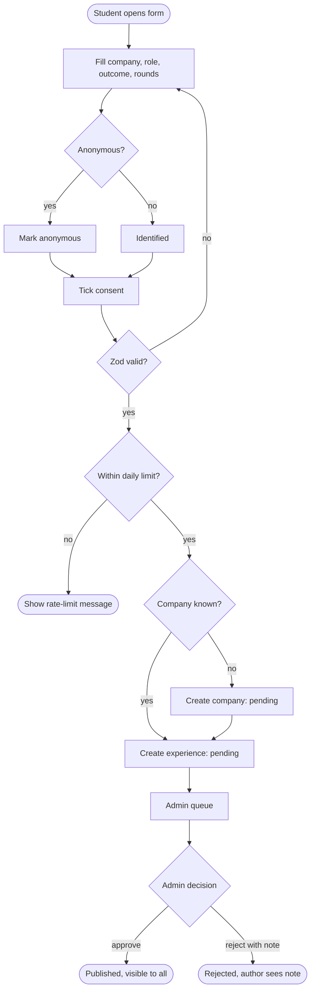
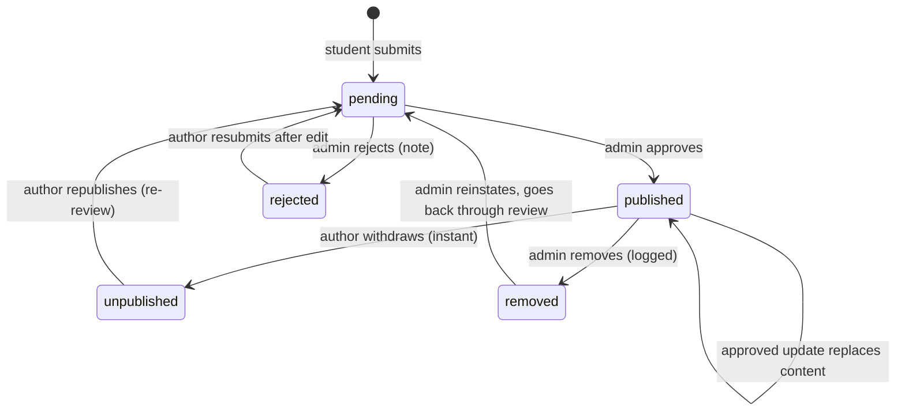

# 6. Sequence, Activity and State Diagrams

Each diagram shows who calls whom, where the trust boundary is, and where a decision from `02-decisions.md` takes effect (noted as `ADR-xx`).

## 6.1 Sign in with domain restriction (UC-04, ADR-05)



## 6.2 Submit an experience (UC-06, ADR-14, ADR-16, ADR-11, ADR-18)

As built, the order is the middleware chain in `routes/index.js`: authenticate, rate limit, validate, controller. The rate limiter is middleware, not a service call.



## 6.3 Admin approves a submission (UC-11, ADR-10, ADR-15)



## 6.4 Vote, idempotent under double tap (UC-09, ADR-07)



## 6.5 AI guide with grounding and fallback (UC-03, ADR-12)

```mermaid
sequenceDiagram
    actor V as Visitor
    participant GS as GuideService
    participant ER as ExperienceRepository
    participant GR as GuideRepository
    participant LC as FallbackLlmClient
    participant GM as Gemini

    V->>GS: getGuide("google")
    GS->>ER: findPublishedByCompany("google")
    ER-->>GS: experiences[]
    alt fewer than minimum
        GS-->>V: NotEnoughData (honest empty state)
    else enough
        GS->>GS: fingerprint = hash(ids + updated_at)
        GS->>GR: find(companyId)
        alt cached and fingerprint matches
            GR-->>GS: cached guide
            GS-->>V: guide (no model call)
        else stale or missing
            GS->>LC: generateJson(prompt, schema)
            loop each configured model until one answers
                LC->>GM: generateContent
                GM-->>LC: JSON | 429 | 503
            end
            alt all models failed
                LC-->>GS: LlmError
                GS-->>V: guide panel shows retry message; page still works
            else success
                GS->>GS: parse with Zod, drop citations not in source list
                GS->>GS: compute counts and top topics in code
                GS->>GR: upsert(guide, fingerprint)
                GS-->>V: guide with citations
            end
        end
    end
```

## 6.6 Public read of one experience, anonymity (UC-02, ADR-06)



## 6.7 Activity diagram: submission to publication (UC-06, UC-11)



## 6.8 State diagram: experience lifecycle (ADR-15)



Transition rules are enforced by the database trigger `guard_experience` and described in code by `ExperienceLifecycle` (`TRANSITIONS`); a test compares the two. The diagram and the code must match: any new transition is added here first.


## 6.9 Edit a live post (UC-07, FR-24, ADR-15, ADR-25)

A live post is never changed in place. The edit becomes a pending update; readers keep seeing the approved version until an admin decides.

```mermaid
sequenceDiagram
    actor A as Author
    actor M as Admin
    participant API as Express (PATCH /experiences/:id)
    participant SV as UpdateService
    participant DB as Postgres functions

    A->>API: PATCH changes (edit limit 20/hour)
    API->>SV: update(id, changes)
    SV->>DB: rpc update_experience
    alt post is published
        DB-->>SV: queued (stored in pending_update)
        SV-->>A: 202 queued, readers still see the old version
    else not live
        DB-->>SV: applied
        SV-->>A: 200 applied
    end
    M->>API: POST /admin/experiences/:id/update/approve
    API->>DB: swap content, re-index search, write moderation log (one transaction)
    DB-->>M: done
    Note over M,DB: reject needs a note; a second edit replaces the first pending one
```
