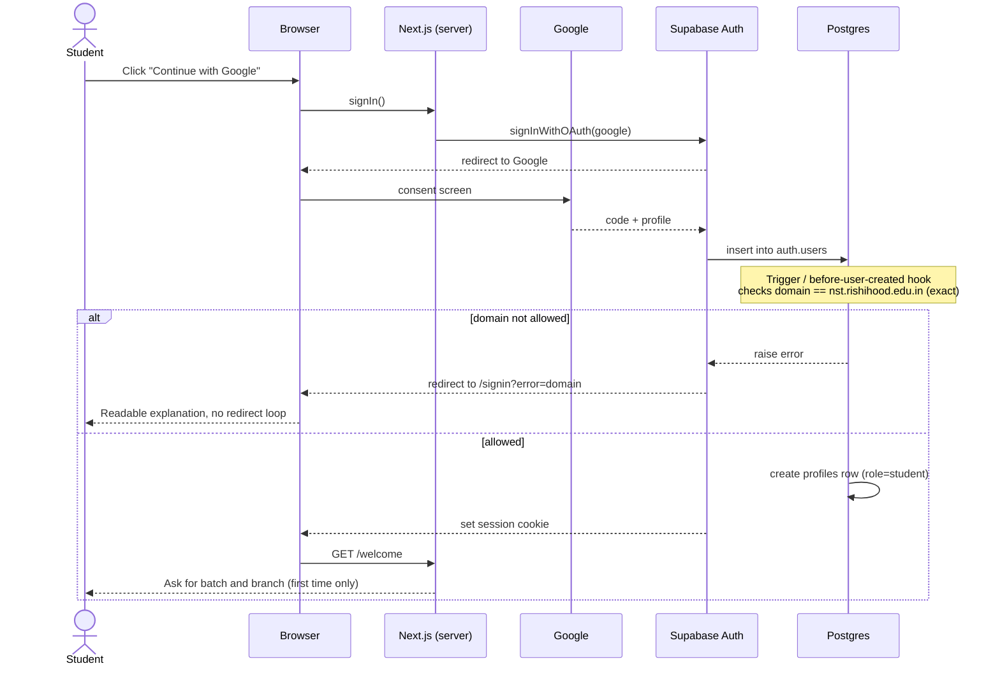
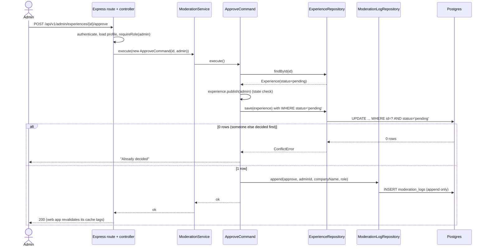
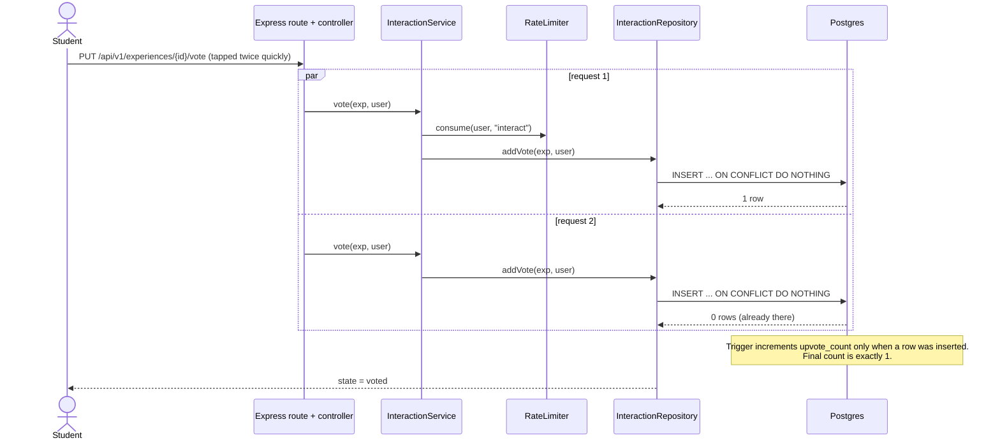
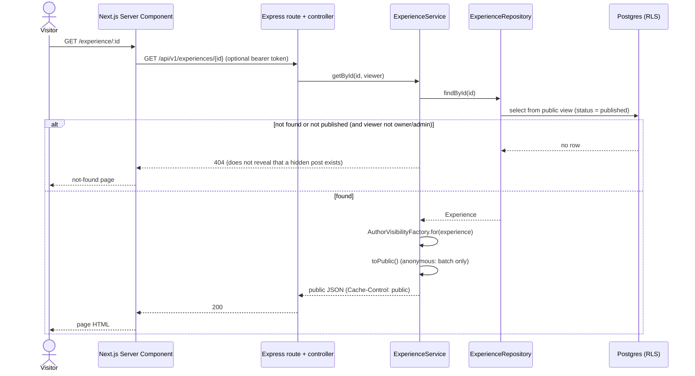
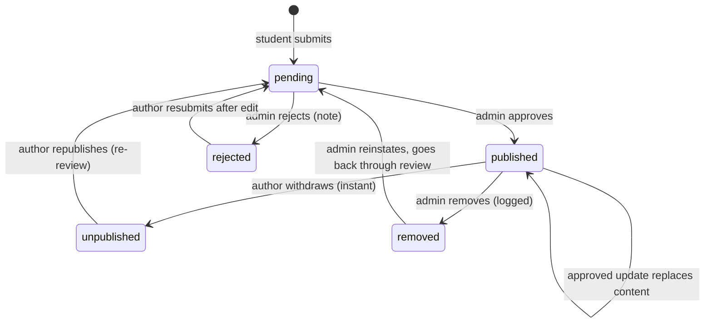

# 6. Sequence, Activity and State Diagrams

Each diagram shows who calls whom, where the trust boundary is, and where a decision from `02-decisions.md` takes effect (noted as `ADR-xx`).

## 6.1 Sign in with domain restriction (UC-04, ADR-05)



## 6.2 Submit an experience (UC-06, ADR-14, ADR-16, ADR-11, ADR-18)

```mermaid
sequenceDiagram
    actor U as Student
    participant C as Express route + controller
    participant Z as Zod schema
    participant SV as SubmissionService
    participant L as RateLimiter
    participant F as SubmissionFactory
    participant R as ExperienceRepository
    participant DB as Postgres

    U->>C: POST /api/v1/experiences (bearer token)
    C->>C: authenticate middleware verifies bearer token (user id from token, never from body)
    C->>Z: parse(form)
    alt invalid
        Z-->>C: field errors
        C-->>U: ValidationError (fields)
    else valid
        C->>SV: submit(dto, author)
        SV->>L: consume(userId, "submit")
        alt over limit (5/day)
            L-->>SV: denied
            SV-->>U: RateLimitedError
        else allowed
            SV->>F: create(dto)
            F-->>SV: QuickSubmission | DetailedSubmission
            SV->>SV: toExperience(author) (snapshot batch, branch; set consent)
            SV->>R: save(experience)
            R->>DB: rpc submit_experience(...) in ONE transaction
            Note over DB: resolve company by slug/alias, else create pending<br/>insert experience, rounds, questions<br/>CHECK consent, status = pending
            DB-->>R: id
            R-->>SV: id
            SV-->>C: SubmitResult(id, status=pending)
            C-->>U: Success screen
        end
    end
```

## 6.3 Admin approves a submission (UC-11, ADR-10, ADR-15)



## 6.4 Vote, idempotent under double tap (UC-09, ADR-07)



## 6.5 AI guide with grounding and fallback (UC-03, ADR-12)

```mermaid
sequenceDiagram
    actor V as Visitor
    participant GS as GuideService
    participant ER as ExperienceRepository
    participant GR as GuideRepository
    participant LC as FallbackLlmClient
    participant GM as Gemini

    V->>GS: getGuide("google")
    GS->>ER: findPublishedByCompany("google")
    ER-->>GS: experiences[]
    alt fewer than minimum
        GS-->>V: NotEnoughData (honest empty state)
    else enough
        GS->>GS: fingerprint = hash(ids + updated_at)
        GS->>GR: find(companyId)
        alt cached and fingerprint matches
            GR-->>GS: cached guide
            GS-->>V: guide (no model call)
        else stale or missing
            GS->>LC: generateJson(prompt, schema)
            loop each configured model until one answers
                LC->>GM: generateContent
                GM-->>LC: JSON | 429 | 503
            end
            alt all models failed
                LC-->>GS: LlmError
                GS-->>V: guide panel shows retry message; page still works
            else success
                GS->>GS: parse with Zod, drop citations not in source list
                GS->>GS: compute counts and top topics in code
                GS->>GR: upsert(guide, fingerprint)
                GS-->>V: guide with citations
            end
        end
    end
```

## 6.6 Public read of one experience, anonymity (UC-02, ADR-06)



## 6.7 Activity diagram: submission to publication (UC-06, UC-11)


## 6.8 State diagram: experience lifecycle (ADR-15)



Transition rules live in `Experience` methods and are repeated as a database CHECK on allowed transitions where practical. The diagram and the code must match: any new transition is added here first.
