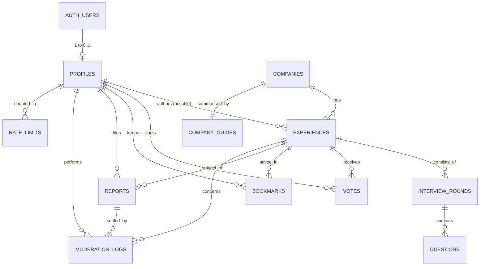

# 8. Database Schema

Mapped one-to-one from the class diagram in `03`. **Draft:** exact DDL is written and applied as migrations in Phase 2 after approval; column names below are the plan, not applied schema.

## 8.1 Entity relationship diagram

## 8.2 Tables

Conventions: UUID primary keys (`gen_random_uuid()`), `timestamptz` for all times, `created_at` default `now()`, enums as Postgres enum types or CHECK-constrained text.

### profiles
| Column | Type | Constraints |
|---|---|---|
| id | uuid | PK, FK to `auth.users(id)` ON DELETE CASCADE |
| email | text | NOT NULL, unique; **never exposed publicly** |
| full_name | text | NOT NULL, length 1 to 120 |
| avatar_url | text | |
| graduation_batch | int | CHECK 2000..2100, nullable until profile step |
| branch | text | CHECK in ('CSE','CSE-AI','CSE-DS','ECE','Other') |
| role | text | NOT NULL default 'student', CHECK in ('student','admin') |
| created_at | timestamptz | |

Role is changed only by server code or SQL, never by a user-writable policy.

### companies
| Column | Type | Constraints |
|---|---|---|
| id | uuid | PK |
| name | text | NOT NULL |
| slug | text | NOT NULL, **unique** |
| name_lower | text | NOT NULL (supports prefix search) |
| aliases | text[] | default '{}' |
| status | text | NOT NULL default 'active', CHECK in ('active','pending') |
| experience_count | int | default 0, CHECK >= 0 (trigger-maintained) |

### experiences
| Column | Type | Constraints |
|---|---|---|
| id | uuid | PK |
| company_id | uuid | NOT NULL, FK companies, ON DELETE RESTRICT |
| company_slug, company_name | text | Denormalised copy for join-free feeds (ADR-02) |
| author_id | uuid | FK profiles, **nullable**, ON DELETE SET NULL |
| author_name | text | Only for admin-posted rows |
| author_batch | int | Snapshot at submit time |
| author_branch | text | Snapshot; never exposed when anonymous |
| is_anonymous | bool | NOT NULL default false |
| role | text | NOT NULL, length 1 to 80 |
| drive_type | text | CHECK in ('on-campus','off-campus','referral') |
| interview_year | int | CHECK 2000..2100 |
| interview_month | int | CHECK 1..12, nullable |
| outcome | text | CHECK in ('selected','rejected','in-process','withdrew') |
| campus | text | NOT NULL default 'ru', CHECK in ('ru','bangalore','hyderabad','pune') |
| status | text | NOT NULL default 'pending', CHECK in ('pending','published','rejected','unpublished','removed') |
| source | text | CHECK in ('submitted','imported','admin') |
| consented_at | timestamptz | **CHECK (status <> 'published' OR consented_at IS NOT NULL)** |
| approved_at, reviewed_by, reviewed_at, review_note | | Review metadata |
| pending_update | jsonb | At most one waiting change, validated by Zod and a CHECK on shape |
| upvote_count | int | NOT NULL default 0, CHECK >= 0 (trigger-maintained) |
| search_tsv | tsvector | Generated, weighted (ADR-17) |
| created_at, updated_at | timestamptz | |

`pending_update` as jsonb is a deliberate exception to ADR-03: it is a transient proposal, never queried by field, replaced wholesale on approval. State this if asked.

### interview_rounds
`id` PK · `experience_id` FK ON DELETE CASCADE · `position` int NOT NULL · `name` text NOT NULL · `tips` text · **UNIQUE (experience_id, position)**

### questions
`id` PK · `round_id` FK ON DELETE CASCADE · `position` int NOT NULL · `text` text NOT NULL (max 2000) · `topic` text (max 60) · **UNIQUE (round_id, position)**

### votes / bookmarks
`user_id` FK profiles ON DELETE CASCADE · `experience_id` FK experiences ON DELETE CASCADE · `created_at` · **PRIMARY KEY (user_id, experience_id)** (the constraint is the feature, ADR-07).

### reports
`id` · `experience_id` FK · `reporter_id` FK nullable (SET NULL) · `reason` CHECK in ('interviewer-named','confidential','false','abusive','other') · `note` · `status` CHECK in ('open','actioned','dismissed') · `resolved_by` · `resolved_at` · partial unique index on `(reporter_id, experience_id) WHERE status = 'open'` to prevent duplicate open reports.

### moderation_logs (append only, ADR-10)
`id` · `action` CHECK in ('approve','reject','approve-update','reject-update','post-on-behalf','remove','reinstate','dismiss-report','approve-company','merge-company','grant-admin','revoke-admin') · `experience_id` nullable FK ON DELETE SET NULL · `admin_id` FK NOT NULL · `report_id` nullable · `subject_id` nullable FK to `profiles` ON DELETE SET NULL (whose role changed, 0013) · `subject_email` (snapshot) · `company_name` · `role` · `created_at`. No UPDATE or DELETE policy, plus a BEFORE UPDATE OR DELETE trigger that raises.

### company_guides
`id` · `company_id` FK **UNIQUE** · `fingerprint` text NOT NULL · `content` jsonb NOT NULL · `source_ids` uuid[] · `model` text · `generated_at`

### rate_limits (ADR-11)
`user_id` (or ip hash) · `action` · `window_start` · `count` · **PRIMARY KEY (key, action, window_start)**; written only through `check_rate_limit()`.

## 8.3 Indexes (each tied to a named query)

| Index | Query it serves | Note |
|---|---|---|
| `experiences (status, created_at DESC, id DESC)` | Home feed, keyset paginated (ADR-08) | `status` leads because every public query filters it |
| `experiences (status, company_slug, created_at DESC, id DESC)` | Company page | Equality columns first, then sort columns |
| `experiences (status, campus, created_at DESC, id DESC)` | Campus-filtered feed | |
| `experiences (status, interview_year DESC, interview_month DESC, id DESC)` | "Sort by interview date" (the alternate `FeedSort`) | |
| `experiences (author_id, created_at DESC)` | My experiences; account deletion fan-out | |
| `experiences USING GIN (search_tsv)` | Full-text search | |
| `companies (slug)` unique; `companies (name_lower text_pattern_ops)` | Slug lookup; prefix autocomplete | `ILIKE '%x%'` would scan, so we use prefix |
| `bookmarks (user_id, created_at DESC)` | My bookmarks | |
| `votes (experience_id)` | Reconcile counts | |
| `reports (status, created_at)` | Moderation queue | |
| `moderation_logs (experience_id, action, created_at DESC)` | History of one post | |

Evidence for the viva: run `EXPLAIN (ANALYZE)` on each list query and show an index scan with rows examined close to rows returned.

## 8.4 Row Level Security summary (ADR-04)

| Table | anon | student (own) | admin |
|---|---|---|---|
| experiences | SELECT where status = 'published' via public view only | SELECT own any status; INSERT via RPC; no direct UPDATE of status | via server functions |
| profiles | no direct access; public fields via view | SELECT/UPDATE own non-role columns | read |
| votes, bookmarks | none | own rows only (bookmarks never readable by others) | none |
| reports | none | INSERT own | read, update status |
| moderation_logs | none | none | SELECT; INSERT through function only |
| companies | SELECT active | SELECT | full |

Every policy has a test per role (anon, student A, student B, admin).

## 8.5 Triggers and functions (planned)

- `auth.users` insert: domain check, create `profiles` row.
- `votes` insert/delete: adjust `experiences.upvote_count`.
- `experiences` status change: adjust `companies.experience_count`; reject illegal transitions.
- `moderation_logs`: reject UPDATE and DELETE.
- RPCs: `submit_experience`, `check_rate_limit`, moderation transitions that need a compare-and-set.

## 8.6 Where the service-role key is allowed (ADR-23)

Everything else runs as the calling user so RLS applies. The service-role client exists only in `apps/api/src/infrastructure/` and is used for exactly these tasks:

| Task | Why a user's rights are not enough |
|---|---|
| `check_rate_limit()` | Users must not be able to write or reset their own counters |
| Writing and reading `company_guides` | The cache is system-owned, not user-owned |
| Appending `moderation_logs` inside moderation functions | Admins insert only through the function, never by direct table access |
| Account-deletion fan-out | Must touch rows owned by the deleted user |
| Scheduled maintenance (counter reconcile) | No user context exists |

Adding a use to this list requires a decision record.

## 8.7 As built (migrations 0001 to 0004, applied 2026-11-09)

Status: **applied to the Supabase project `PrepLens` (ref `hygafqegwxnrfnhsxmgq`, ap-south-1)**. SQL lives in `supabase/migrations/`. Differences from the plan above, and why:

| Plan | As built | Why |
|---|---|---|
| Public "view" for reads | Security-definer **functions** (`list_experiences`, `get_experience`, `get_stats`) | Views run with owner rights and trip the advisor; functions also let the anonymity rule (`_author_json`) live in one place. Base tables have RLS on, **no policy and no grant**, so direct table access is closed |
| Moderation via direct writes | `moderate_experience(id, action, note)`: admin check, compare-and-set update, log insert, settle open reports, one transaction | ADR-14, ADR-10 |
| Votes and bookmarks via policies | `vote_experience`, `bookmark_experience`, `my_interactions` functions over primary-key tables | ADR-07 |
| (0005) | `admin_list_experiences` (admin queue with open-report counts, no author identity) and `list_my_bookmarks` (keyset on the bookmark time) | the web app needs both lists |
| `pending_update` workflow | Column exists; the propose/approve functions are not built yet | Feature phase |
| Interview-date sort | Index exists; `list_experiences` sorts newest first only | Feature phase |

Error convention: functions raise `P0001` with `"CODE: message"` where CODE is one of `UNAUTHENTICATED`, `FORBIDDEN`, `NOT_FOUND`, `CONFLICT`, `VALIDATION`. The API maps CODE to its `AppError` classes. A failed college-domain check raises `P0001` from the `auth.users` trigger.

Advisor result after hardening: security shows only the intended API functions (callable by anon/authenticated by design) and the "RLS enabled, no policy" INFO on tables that must stay closed.

Verified in a rolled-back test: non-college, lookalike and `nst.rishihood.edu.in@gmail.com` emails rejected; profile created and admin promoted from `admin_emails`; company names "Example  Co" and "example co" resolve to one row; no consent and a future date rejected; pending posts invisible to anon; double approve returns CONFLICT; a student cannot moderate; anonymous payloads carry `{anonymous, batch}` only; a double vote leaves the count at 1; the moderation log blocks UPDATE and DELETE; rate limit allows 5 of 7; anon and authenticated cannot touch tables, call the rate limiter, or change their own role.

## 8.8 Migrations 0006 to 0009

| Migration | What |
|---|---|
| 0006 | `guard_experience` ignores `search_tsv`, so a new post is not marked "edited" |
| 0007 | `list_company_sources` (published posts only, authors anonymised) for the AI guide |
| 0008 | `admin_list_pending_companies`, `admin_decide_company` (approve or merge, logged); `moderation_logs.action` gains `approve-company` and `merge-company` |
| 0009 | `update_experience`, `cancel_experience_update`, `admin_list_updates`, `admin_decide_update`, `admin_post_experience`, `admin_list_reports`, `admin_dismiss_report`, `prepare_account_deletion` (service role only); `get_experience` shows the owner and admins the waiting change |

Behaviour of `update_experience`: a post that is `published` stores the proposed change in `pending_update` and keeps serving the approved version; a `pending`, `unpublished` or `rejected` post is edited directly (a rejected one returns to `pending`); a `removed` post cannot be edited; changing `isAnonymous` applies at once. Company changes are not editable. Tests: `supabase/tests/004_updates_deletion_onbehalf_reports.sql`.

**0010** (2026-11-10): `list_experiences` gained `p_sort` (`newest` or `interview`) with its own keyset `(interview_year, coalesce(interview_month, 0), id)`; index `exp_interview_sort` replaced the unused `exp_interview_feed`. Test: `supabase/tests/005_feed_sort.sql`.

**0013** (admin roles, ADR-31): `moderation_logs` gains `subject_id` and `subject_email` and the actions `grant-admin` and `revoke-admin`; the append-only trigger also allows the FK null-out of `subject_id`. Functions: `admin_list_admins()`, `admin_grant_admin(email)`, `admin_revoke_admin(user_id)`, all admin-only and executable by `authenticated`; both writes go through the internal `_change_role` (no grant), which takes `pg_advisory_xact_lock(hashtext('preplens.admin_roles'))`, re-checks `is_admin()` after the lock, refuses self-removal and removing the last admin, deletes a revoked email from `admin_emails`, and logs the change. Test: `supabase/tests/007_admin_roles.sql`. **Status: written, not yet applied** (apply with the Supabase MCP `apply_migration` or the SQL editor, then run the test).

